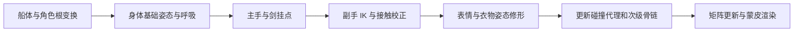

# 武侠主页：可替换、可动画的模块化角色制作调研

调研与本地核对：2026-09-25。状态：**研究建议，未获得实施批准**。范围仅武侠主题；保留现有 Three.js/WebGL 与 HTML 功能层。此次没有修改模型或产品代码，没有安装软件、生成图片、上传资产、调用收费接口或提交绑定／动画任务。

配套阅读：[逐图复用与补充输入](modular-character-reference-reuse.md) · [来源、版本、费用与证据边界](modular-character-research-sources.md) · [文档索引](../README.md)。

## 1. 结论与需要选择的取舍

**应当拆分，但拆分依据是变形、替换和接触关系，不是把每个可见零件分别交给 AI 生成。** 推荐以同一个完整角色母体、同一套身体骨架和已确认的比例制作服装与头发，剑和刚性饰品使用挂点；运行时只有真正需要更换的模块独立加载。独立生成的衣服、头脸和身体，即便缩到同样高度，也不会自动拥有相同肩宽、关节位置、颈口、权重和坐姿空间。

这次证据更支持“先取得可变形母体与模块接口，再追求细节”的顺序，但**不预先指定必须换成某个商业角色**。应在短小样中比较两条路径：

| 路线 | 获得什么 | 主要代价 | 推荐条件 |
|---|---|---|---|
| A：保留现有 Ultra 形象，人工重拓扑／分层重建 | 最容易保留已认可的脸和服饰设计；旧高模可用于比例及局部烘焙 | 补全隐藏身体、重做脸部环线／眼球／口腔、蒙皮、衣服结构和全部脏头发；减面不能替代这些工作 | 用户把现有脸形还原放在首位，接受更多角色美术工时 |
| B：标准可绑定母体改型，重建武侠外观 | 提前获得连续身体、手指和面部变形基础；服装适配可重复 | 脸形与身材需要人工对齐；商业母体可能有运行时换装许可限制；现有整身高模不能直接当衣服套上 | 用户重视后续多发型／多服装、自然表情与维护成本 |
| C：固定坐姿展示资产 | 同一镜头下更快达到好看的待机效果；可预制衣裙褶皱 | 动作范围与组合数量明显受限，不能宣传为通用可换装角色 | 用户愿意暂缓自由换装／大幅动作；仍保留后续升级分件 |

本报告推荐 **B 为长期架构候选，A 为身份保真对照，C 为可交付回退**。先比较“中性脸＋闭眼、交叠坐姿、一个衣片和一束长发”，而不是付费再生成整个人。标准母体的价值来自已验证的变形与接口，不来自品牌或更少面数。

后续需要用户选择的只有三个主要取舍：

1. **相似度与可维护性**：允许在保持同一人物观感的前提下改型标准母体，还是要求尽量精确保留现有 Ultra 脸形？前者倾向 B，后者倾向 A。
2. **更换发生在哪里**：制作人员在 DCC 换装后导出多个预设，还是最终网页让用户实时换发／换衣？本报告设计兼容后者，但它增加组合测试、运行时和许可成本。
3. **首版动作范围**：推荐固定交叠坐姿、自然呼吸、眨眼、微转头、稳定持入鞘剑及有限次级运动；起身、换腿、拔剑、战斗另立阶段。

现有主图、9 张制作图均保留。无需把整套参考推倒重来；需要补的是被遮挡的结构与模块接口，不是更多漂亮整景。

## 2. 真实资产说明了什么

已读取 台账、图片接收清单 及 Ultra、保护减面、4K 纹理、v14、v17、上一轮头发调研和旧交接文档。此次逐张查看主图、R01–R08（R08 两张）及用户反馈截图，重新计算接收清单 10 个文件的 SHA-256，全部匹配；归档副本不是第 10 张独立制作参考。

直接解析实际 GLB 的 JSON 与 accessor 计数，并计算哈希：

| 文件阶段 | 三角形 | 文件字节 | skin / animation / morph target | 本次判定 |
|---|---:|---:|---|---|
| Ultra 4K 母版 | 4,506,766 | 107,799,740 | 0 / 0 / 0 | 保留形象与雕刻参考，非动画母体 |
| cleanup-v4 | 1,206,365 | 65,578,440 | 0 / 0 / 0 | 一个 primitive；清理历史对照 |
| straight-hair-v14 | 882,486 | 54,805,828 | 0 / 0 / 0 | 两个 primitive；厚壳方向未获认可 |
| layered-hair-v17 | 855,110 | 55,660,864 | 0 / 0 / 0 | 两个 primitive；新背发 22,288 面，用户仍不满意 |

v17 SHA-256 为 `521d4f000783c70f3d58d3f61a9ee9a822a0ec8fd698ecdee61cf1ed66688d68`。这证明文件身份和无绑定／无动画状态，不证明可变形、无自交或性能合格。

红框包含前垂发束以及肩颈旧碎片。v17 只替换 v14 的第二个 primitive；第一个仍含身体、面部及保留头发／衣饰。**保留区逐字节不变，是“没有误改”的证据，也是旧缺陷继续存在的原因之一。** 不能继续只改背部、增加遮挡外壳，然后把前发问题当作已解决。截图也不能单独区分每一块黑色来自网格还是贴图；应在后续 DCC 中隔离材质和选区检查。

4K retexture 还曾把 1,216,304 面变成 1,206,676 面、五个 primitive 合成一个、坐标归一化。这一实际记录说明：后续一旦建立权重、morph 或模块边界，就不能未经读回比对把生成式重贴图输出替换整个绑定模型。详见 [4K 纹理报告](wuxia-character-texture-4k.md)。

台账累计 **65 / 600 credits，剩余项目预算 535**；8035 是上次记录的账户余额，此次未查询在线余额。v17 的 `art_approved=false`，当前用户意见优先于旧文档的“待审”“无需补图”和早期 25／55 credits。旧记录中的“尚未制作纹理”仅适用于旧阶段。

## 3. 工业流程的共同点与适用边界

成熟流程把设计、高模、可变形网格、蒙皮、动画控制和运行时表达分开。Epic 的模块角色文档展示共享姿态、复制姿态和合并网格的不同成本；共享姿态并不消除各部件的绘制成本。我们借鉴其“统一骨架＋明确模块边界”，不移植 Unreal 的 Leader Pose API。[Epic 模块角色文档](https://dev.epicgames.com/documentation/unreal-engine/working-with-modular-characters-in-unreal-engine)

Reallusion 官方发布的 CC5 制作案例仍先改母体，再处理衣服／头发／护甲的重拓扑、UV、材质、权重和遮挡；自动适配不是完整角色作者流程的替代品。其资产指南也明确把权重转移视为起点，残余问题需要手工修正。[CC5 制作案例，2026-02-12](https://magazine.reallusion.com/2026/02/12/creating-a-knight-king-sardon-with-character-creator-5/) · [资产制作注意事项](https://wiki.reallusion.com/Content_Dev:CC_Asset_Production_Precautions)

三种“分件”必须独立验收：

| 层次 | 含义 | 本项目例子 | 不能推导出的能力 |
|---|---|---|---|
| 制作时分件 | DCC 中可单独选取、建模、烘焙 | 衣袖、衣领、裙片分别调整 | 不代表导出后仍保留对象或挂点 |
| 导出时分件 | GLB 中独立 node / mesh / primitive / material | 剑、发型、服装保留语义对象；材质分 primitive | primitive 不自带独立 transform；存在两个 primitive 不等于两个可替换模块 |
| 运行时可替换 | 模块满足同一契约，可加载／解绑／替换／释放 | 发型 A/B 共用头皮接口，服装使用同一身体骨架 | 文件格式合法不保证尺寸、蒙皮、碰撞、许可证与所有组合兼容 |

## 4. 合理拆分粒度与模块契约

### 4.1 建议粒度

以下为项目方案，不是所有角色都应照抄的标准。

| 模块 | 制作时 | 运行时替换单元 | 主要驱动与适配要求 |
|---|---|---|---|
| 基础身体＋头脸 | 优先同一连续可变形母体；按需要拆工作对象 | 首版固定一个 body/head 版本 | 共享身体骨架；脸部独立表情通道；完整身体母版保留 |
| 眼球、牙齿、舌、睫毛 | 分件；闭嘴首版可简化口腔深处 | 跟随头脸包，不作为随意混搭商品 | 眼球枢轴、眼睑贴合；牙齿随头／下颌；不得把闭嘴图片当口腔拓扑 |
| 头皮、发髻、前发、背发、边缘发片 | 按发流和运动区分组 | **整个发型包**为默认换发单元，内部可多网格 | 共用 scalp fit、发际线、耳区和头饰区；不同发型可有自己的附加骨链 |
| 发冠／簪本体、链条／玉坠／穗 | 刚体与活动部分分开 | 发饰套件，标记兼容发型 | 本体挂 head socket；坠饰附加骨骼；固定簪不整根软化 |
| 内层衣、外衣、袖、裙片 | 按裁片／层次制作 | 首版完整 outfit；之后再开放有明确重叠规范的上装／下装组合 | 身体骨架蒙皮＋袖裙附加骨骼＋姿态 corrective；对身体与其他衣层规定留量 |
| 腰封、护腕／护甲、靴 | 制作独立；可以与对应服装打包 | 有替换需求才独立 | 护腕可刚性随前臂，跨肘件需分段；腰封／软靴不可一律当刚体 |
| 剑柄＋入鞘剑体 | 首版刚体整体 | 独立 weapon 包 | 单位、重心、右手主握与左手扶点、握持姿态配置 |
| 剑穗 | 链节／穗束分工作组 | 随 weapon 包交付 | 根挂剑柄，少量骨链／弹簧；无需逐根流苏独立骨骼 |
| 船、横座、接触／碰撞代理 | 视觉和碰撞分开 | 场景包 | seat socket、座面高度、地板和船舷碰撞；不加入人体骨架 |

“每根发丝独立运动”在网页目标下改为：**导向曲线控制发束，若干发片随同一骨链变形，纹理表达细丝**。前发、背发和坠饰可以有不同动力参数，但根部始终与同一头部运动一致。

### 4.2 统一母体具体固定什么

应在未来作者工程与清单中冻结以下字段，再做第二套衣服／头发。它们是拟议接口，当前项目尚未实现。

| 契约 | 应保存的数据 | 失败时表现 |
|---|---|---|
| 度量／朝向 | 导出单位米、右手坐标、+Y 向上、角色正面 +Z；原点、身高及脚底基准；记录 DCC 转换矩阵 | 不同模块各自归一化，剑／头发尺度不一致 |
| 母体版本 | `bodyProfile`、头围、肩／胸／腰／髋、臂腿长、手掌／握柄尺寸；本任务不从图片臆造真实数值 | 衣服仅腰围吻合但肩肘错位 |
| bind pose | 选定一个 A-pose；固定关节位置、层级、轴向、roll、rest local transforms、inverse bind matrices | 骨名相同却穿衣即扭曲 |
| 蒙皮映射 | 每模块 joint 索引到标准 joint ID 的映射；权重归一、影响数约束、绑定矩阵 | 各 GLB 的关节数组顺序不同，错误蒙到其他骨骼 |
| 表情／修形 | 语义名、范围、默认值、身体与衣服 corrective 配对；修改顶点顺序后的版本作废规则 | 衣服不随呼吸，嘴唇／眼睑错误变形 |
| 接口与挂点 | scalp fit、neck seam、耳区、头饰禁入体积、左右手握点、剑扶点、座位参考 | 发型悬空、颈部裂缝、手掌离剑 |
| 遮挡／碰撞 | outfit 隐藏身体区域、透明衣料例外、裙与袖的占据体积、头发长度档、碰撞组 | 以隐藏皮肤掩盖外衣互穿，换装后身体缺失 |
| 兼容与资源 | `skeletonVersion`、`moduleVersion`、材质与贴图集、LOD、单位、许可来源、哈希、允许组合 | 加载成功但组合未验收，或旧接口混用 |

glTF 规范负责单位、层级、skin 与 animation 等传输语义；上述衣物适配、socket 命名和兼容矩阵是项目自定义契约，不是 GLB 自动提供的能力。[glTF 2.0 规范](https://github.com/KhronosGroup/glTF/blob/main/specification/2.0/Specification.adoc)

头部与身体优先保持同一母体。确有换头需求时，应固定颈口对应边界、rest position、权重和法线；头身的肤色、粗糙度、法线空间也需一致。**共享骨架不要求所有模块拥有相同顶点数；同一网格的 morph 才依赖对应顶点。** 颈口即使在静态贴合，也要在转头、低头、耸肩中检查，不能只靠项链遮缝。独立 Meshy 头像与身体的拼装通常把问题转移到颈口和身份一致性，不宜作为默认路线。

服装适配流程：在标准母体上调整裁片／外壳与留量 → 转移权重 → 手工修正肩腋／袖／髋膝 → 坐姿与呼吸 corrective → 建立隐藏身体区域 → 检查全部受支持姿态。最近点权重转移可能把裙摆误配到对侧腿、把长袖配到躯干，因此必须先限制转移区域。透明纱袖和露肤开口不能一起删除下方身体。作者母版保留完整人体，发行派生版才按 outfit 裁去或隐藏永不可见区域。

运行时装配优先一套身体骨架；服装映射到这套实际骨对象，不是导入两套同名骨骼各自播放。头发附加骨链应命名隔离、根挂 head，并清楚登记谁更新它。可先用“一个 GLB 内含基础角色和两套互斥模块”验证接口，再实现多个 GLB 的按需换装，避免第一步就引入复杂加载问题。

## 5. 动画分工：主动作统一，次级运动依附

### 5.1 各系统的责任

| 需求 | 首选制作／控制 | 需要的资产 | 不应采用的替代 |
|---|---|---|---|
| 呼吸、胸廓与腹部起伏 | 小幅胸廓／脊柱动作，必要时配 breath morph 与姿态修形 | 胸腹拓扑、胸廓控制；内外衣相同呼吸驱动 | 整个人物周期缩放，或两侧胸部各跑一段随机弹跳 |
| 胸部软组织 | 默认随胸廓和衣物约束；只有可见且必要时加极轻的受控修形／次级骨 | 支撑关系、幅度限制和服装修形 | 将柔软组织运动当作呼吸主动力；先加物理再修穿插 |
| 交叠坐姿、微转头 | 身体骨架姿态、动作层／有限 additive，保持座位接触 | 髋膝／肩肘有效权重，姿态 corrective | 仅旋转几个节点而忽略蒙皮和裙片结构 |
| 眨眼、平静表情、视线 | 眼球旋转＋眼睑／唇角等 morph；按表情混合 | 眼球、眼睑环线、局部眉嘴拓扑；必要口腔 | 贴图眨眼充当近景闭眼，或把 auto-rig 当作完整面部 rig |
| 持剑与手指 | 一只手为主握；剑根跟随主手；副手 IK 对准剑上扶点；手指握姿预制 | 指骨、掌心握点、手腕偏移、每把剑握径 | 剑跟双手同时 parent；骨架、剑各播互不关联动画 |
| 长发 | 发根跟头；活动长度由骨链／烘焙驱动；可加受限弹簧 | scalp 权重、链长、胸背肩碰撞体 | 把每根纹理发丝变成独立物理对象 |
| 发饰、耳坠、剑穗 | 固定件刚性挂接，垂件骨链／弹簧 | 固定端、角度限幅、阻尼、碰撞组 | 把簪本体和发髻都当软绳，或与船分别随机摇摆 |
| 长袖、长裙 | 首版坐姿造型＋骨骼／少量 corrective；离线模拟可辅助定型 | 裁片结构、层次、与腿／座面接触 | 默认把离线布料缓存当浏览器布料模拟 |
| 船体起伏 | 船与人物共享父层；人体只做相对运动 | 船空间／世界空间约定 | 船、人、剑独立叠加世界位移导致双重运动 |

Three.js 可播放 skin／morph 并提供 IK 辅助类，但 IK 仍需明确骨链、目标和限位，不会自动理解剑柄、座位或手指接触。[SkinnedMesh](https://threejs.org/docs/pages/SkinnedMesh.html) · [CCDIKSolver](https://threejs.org/docs/pages/CCDIKSolver.html)

### 5.2 建议的每帧更新顺序

这是拟议顺序，须在小样中证明。原则是每个通道只有明确的最终写入者：基础动画不再覆盖刚算好的 IK；弹簧不再次更新已经烘焙的同一骨链；breath driver 统一驱动身体与衣物。表情与身体动作可并行计算，但共享命名和混合策略。根据实现，碰撞矩阵更新可能需要在 IK 前后各刷新一次。

船的升降与头发的重力要选择参考空间：首版可在船空间用温和风场近似，并明确不模拟真实船体惯性；若需要惯性，使用世界根位移／加速度驱动，不能重复加入船摇摆。切换模块、暂停恢复或标签页回到前台时重置弹簧历史位置，限制 delta time，避免一帧爆甩。

### 5.3 坐舟持剑的最小可行小样

使用已选母体的低成本代理、简单横座／底板、圆柱剑柄占位，不先造正式舟剑。顺序为：

1. 固定身高、座高、骨盆支撑与交叠腿顺序；主图定观感，R08 辅助，隐藏腿由合理三维姿态确定。
2. 加主握、扶剑和五指握姿；让胸廓做一轮小幅呼吸，验证腕部与剑的接触不漂移。
3. 加简化长裙：膝上受约束区、臀后接触区、侧垂裙片分开控制。碰撞代理至少覆盖大腿／小腿、骨盆、座面、船舷、胸背／肩。
4. 加一束前发和一束背发：前发不得穿胸与领口，背发不能穿座板或陷入背部。坐姿会缩短头到座位距离，站姿安全不代表坐姿安全。
5. 加眨眼、微转头、一个吊坠和剑穗，最后加船体低幅运动。先各系统单独开关，再检查组合循环和切换。

建议先做 6–10 秒循环和几种极限姿态；这只是项目试验长度。长裙与长发在固定坐姿可用预制外观＋有限骨骼摆动达到较稳定结果，通常比第一版实时全布料可靠。若目标扩展到换腿／站起，必须扩大姿态集、碰撞和衣片解算，不能沿用该小样验收。

## 6. 头发需要重建的是什么

成熟 groom 输入是**可编辑的发根、导向曲线、分区、束宽、流向与层次**。Houdini 可从导向曲线直接生成卡片，也可将相邻毛发聚成卡片并生成纹理；Maya/XGen 同样能将 groom 转成多边形条带。当前 Meshy 网格没有这些作者语义，不能反向假定每条隆起都是可靠发束。[SideFX 发片流程](https://www.sidefx.com/docs/houdini/fur/haircards.html) · [Maya/XGen 转卡片](https://help.autodesk.com/cloudhelp/2023/ENU/Maya-CharEffEnvBuild/files/GUID-33279585-C22F-4E3E-880F-6EFD3D0BFA9A.htm)

针对当前模型的正确先后关系：

1. **建立语义选区**：皮肤、前发、耳后发、背发、发髻、饰品、衣领逐区标记。关闭纹理、查看背面和截面；空间阈值／颜色只能辅助，不能自动决定删除范围。
2. **处理旧源网格**：在派生作者工程中删除确认的旧发片／桥接，修复被遮挡的头皮、耳后、颈肩和衣料。若前发与衣服已经不可可靠分离，应局部重建衣片／皮肤；不继续加黑色外壳遮住它们。
3. **独立清理材质污染**：旧发丝烘入脸／领口的基础色或法线时，修改几何并不会消失；分材质烘焙／修图，避免再将污染转投回新 UV。
4. **定义发型层**：贴头体积／发际线、发髻、左右前发、背部主束、表层与零散边缘。服饰链条与前发可视觉重叠，但不能共享不可分的网格。
5. **曲线到发束／发片**：用可控曲线给发流、长度、分束和根梢宽度；纹理图集表达细丝、覆盖和法线。几何表达轮廓与活动长度，不雕出全部细丝。
6. **烘焙与网页着色**：颜色／alpha、normal、roughness；按需要生成 flow/tangent 等数据，验证坐标约定。现有 v17 程序图集可以作为 shader 技术对照，不能当作已批准的发型或成熟 groom 烘焙。
7. **先验证一小束，再扩展**：同相机检查灰模、纯基础色、PBR、深浅背景、侧面和逆光；加骨链后检查摆动，再制作完整发型和 LOD。

可保留薄内部遮挡层，但应贴合干净头皮／发型体积，且其用途是支撑发片覆盖，不是隐藏旧错误。发髻不需要大片柔性摆动；发根基本固定，中下段才产生位移。发片边缘需要适量透空，不能把所有边都焊成密闭体；模型检查器也要区分有意开放卡片和破洞。

头发材质可使用 `KHR_materials_anisotropy` 与 Three.js 通用各向异性近似；它不等于完整纤维散射。MASK、alpha-to-coverage 与 alphaHash 是不同策略，需检查发丝远景闪烁、阴影覆盖和 MSAA 渲染目标。少面数发片仍可能因为大面积透明重叠而很慢。[Three.js 物理材质](https://threejs.org/docs/pages/MeshPhysicalMaterial.html) · [Material](https://threejs.org/docs/pages/Material.html)

## 7. Meshy 的能力与限制矩阵

核对层次：网页产品文档、公开 API、本机 CLI 0.3.0 帮助／资源列表、本机 MCP 0.5.1 包源码。此次没有真实调用生成来验证输出质量；本会话也未暴露 Meshy MCP 可调用工具，包已安装不等于当前会话已接通。

| 环节 | 网页／API 公开能力 | 本机 CLI / MCP 证据 | 对本项目的合理定位与未证实部分 |
|---|---|---|---|
| 概念／多视图图片 | 提供图像生成及编辑 | CLI 有 text-to-image / image-to-image；MCP 有对应注册 | 已有 ChatGPT 图优先复用，不增加付费图片；多视角一致性仍需审查 |
| 图生高模 | standard / Ultra 等 | CLI image-to-3d；历史任务证实已取得 Ultra 母版 | 高模参考、轮廓探索；不保证隐藏人体、衣物内层或脸部变形拓扑 |
| 原生分件低模 | **Smart Topology / meshy-t2 明确宣传原生分件、三角面及面数控制** | CLI 帮助明确 separated parts，目标 100–15000；MCP schema 和请求支持 smart-topology | 可以作为新道具／粗模块候选，不能推断语义分件精确、接口固定、每次同拓扑或能保留现有脸 |
| 对现有模型拆件 | **Auto Split**：按自动、部位名、颜色区域拆可打印对象 | CLI resources 无专用 Auto Split；原始 API 通道存在但未试；MCP 24 个注册工具未见 Auto Split | API 会重建切块、加固薄区、不保留原纹理；不是本项目带权重发片／衣物的无损拆件方案 |
| 减面／重网格 | Remesh 可调整 topology 和目标面数 | CLI remesh / MCP meshy_remesh | 提供网格简化候选；quad 选项不保证眼口环线、裙片和关节布线合理 |
| 纹理／UV | Retexture 有保留 UV、PBR 和分辨率选项 | CLI retexture / uv-unwrap；MCP 对应工具 | 可作粗材质或纹理来源；不承诺固定顶点、skin、morph、模块边界原样往返，必须读回核查 |
| 自动人体绑定 | API 面向清楚四肢的纹理化双足类人；网页文档还描述其他体型 | CLI rigging / MCP meshy_rig；GLB/FBX 和基础动作输出 | 可试验基础身体 rig；手指数量、扭转骨、脸部 morph、裙／头发骨和权重质量不能凭“成功”推定 |
| 预设动作 | API 对已有 rig 应用动作；动作目录 | CLI animate / MCP meshy_animate | 可作身体动作起点；不能保证交叠腿、双手持剑、衣物与船座安全 |
| 文字生成动作 | 独立 Text to Motion API | CLI 有 text-to-motion；此版本 MCP 注册未见该项 | 独立动作片段仍要 retarget、接触修正；不是给此人物连衣带发自动做好动作 |
| 标准身体基础／面部拓扑 | 所查接口未给出固定人体拓扑、面部表情规格或拓扑对应保证 | 未发现相应输出契约 | **未知／无承诺证据**；不能当作 CC 类参数母体替代 |
| 衣物版型／适配／权重转移 | 所查接口未提供纸样、目标 avatar 贴合、模块权重转移契约 | 未发现对应专用能力 | 交给 DCC／服装工具；不因生成了裙子就声称存在裁片或穿衣接口 |
| 发丝 groom／可换装接口 | 未见导向曲线、标准 scalp、发片图集与统一骨架模块契约 | 未发现专用能力 | 用其图像／网格作设计参考，生产结构需另外制作 |

直接依据：[网页功能入口](https://docs.meshy.ai/en/webapp/getting-started)、[Image to 3D](https://docs.meshy.ai/en/api/image-to-3d)、[Auto Split](https://docs.meshy.ai/en/api/auto-split)、[Remesh](https://docs.meshy.ai/en/api/remesh)、[Retexture](https://docs.meshy.ai/en/api/retexture)、[Rigging](https://docs.meshy.ai/en/api/rigging)、[Animation](https://docs.meshy.ai/en/api/animation)、[Text to Motion](https://docs.meshy.ai/en/api/text-to-motion)。版本与本机路径见来源附录。

两项特别边界：

- Auto Split 输入是受支持的既有任务 ID，不可推定能直接提交本地 v17；即使拆出头／衣服，也没有重建可换装衣服内层与完整身体的保证。
- Rigging 页面正文对 `input_task_id` 写出 300,000 faces，错误说明也列面数超限；本机 Skill 使用统一 300k 预检。不能把 `model_url` 当作已证实的绕过方式；v17 不应直接送绑。低模代理转权重同样不能修复原高模错误连通性和表情拓扑。

## 8. 工具方案：买的是作者效率，不是自动完成

需要的是一个能交互修拓扑、权重、曲线和姿态的 DCC。Blender 与 Maya 是主作者工具的替代关系；Houdini 是有批量 groom／程序化需求时的专项选择；并不需要全部购买。

| 工具 | 在本任务中的用途 | 必须／可选与主要代价 |
|---|---|---|
| Blender | 手工重拓扑、权重／shape keys、曲线发束、简单布料、烘焙、GLB 组装与动画导出 | **个人路线首选主 DCC**；许可证成本 0，学习与角色美术工时不可省。本轮未安装或运行 |
| Maya / XGen | 成熟绑定、动画、面部、曲线 groom 与 cards | 可替代 Blender；团队已有经验时价值更大。进入 GLB 仍要验证导出器／FBX 中转和材质，不依赖约束原样输出 |
| Houdini | 可重复发束分区、cards／图集、程序化与模拟 | 多发型量产时可选；单个人物同时学它和主 DCC 往往增加起步成本 |
| Character Creator 5 | 标准身体、改脸、表情、服装权重与适配工具 | B 路线加速器，非必须；标准母体不自动等于目标脸。用户端换装的许可需单独确认 |
| iClone | 动作编辑、重定向、接触与表情编排 | 动作数量多时选；首版短坐姿循环可在 Blender／Maya 完成，无需为了绑定同时购买 |
| Marvelous Designer | 在目标母体上做纸样、缝合、垂坠与坐姿布料参考 | 武侠长袖长裙很有价值但可选；仍须整理游戏拓扑、权重与发行表达 |
| Substance 3D Painter / Designer | 分材质烘焙、PBR 绘制、刺绣／布料／磨损图集 | 可选；用 Blender 烘焙／绘制起步，材质返工变多再购买 |
| Mixamo | 基础类人自动绑定、动作库 | 免费可选，需 Adobe ID；替代 Meshy 的部分身体 rig／动作来源，不能替代面部、长裙、长发、持剑接触制作 |
| Three.js＋现有本地工具 | 骨骼／morph 播放、模块装配、运行时约束、压缩与性能验证 | 发行必须；不把代码变换当作完整美术作者工具 |

工具依据：[Blender 许可](https://www.blender.org/about/license/)、[官方 glTF 导入导出器](https://github.com/KhronosGroup/glTF-Blender-IO)、[XGen 转换](https://help.autodesk.com/cloudhelp/2023/ENU/Maya-CharEffEnvBuild/files/GUID-33279585-C22F-4E3E-880F-6EFD3D0BFA9A.htm)、[CC5](https://www.reallusion.com/character-creator/)、[Mixamo FAQ](https://helpx.adobe.com/creative-cloud/faq/mixamo-faq.html)。

**个人／小团队路线**：Blender＋可合法交付的同一角色母体＋现有 Meshy 高模／设计图＋Three.js；头发先手工曲线／发片，不要求 groom 插件。若选 B，可评估 CC5，但公开换装许可未明确前，优先考察自行制作／委托制作或许可明确允许所需用途的母体。MD 可只在制作武侠服装的月份使用；Painter 也不应成为第一阶段门槛。

**更完整生产路线**：角色美术人员用 Maya 或 Blender 建母体与面部，MD 做长衣裙，Houdini 或 XGen 做 groom/cards，Substance 做纹理；动画师用主 DCC 或 iClone 做动作与接触，技术美术统一导出到 Three.js。软件增加的价值是减少反复手工和提高可控性，不能消除角色审美、拓扑与变形验收。

费用快照（USD，2026-09-25 公开页；非本地含税报价）：Blender 0；CC5 Standard 页面 299；iClone 8 标价 599；Houdini Indie 299/年或 449/两年；MD Personal 39/月或 280/一年预付。Substance 当前计划页可读 Collection 59.99/月，2025 官方价格 FAQ 的 Texturing 24.99/月只作为历史档位，未确认当前地区可购买。Maya 地区动态价未可靠取得，不填猜测金额。iClone Personal 当前有 30 次、每次 30 秒的 3D 导出限制，不可按无限免费出口预算。来源及许可条件见 [费用附录](modular-character-research-sources.md#costs)。

因此可从 **0 软件采购＋人工工时**开始；选择 CC5＋一个月 MD 的公开标价合计 338（不含授权扩展、内容包、税费与人工）。这只是采购组合计算，不代表完成角色的总价。

### 人工工时与 AI 自动化边界

以下是本项目规划估算，不是行业统计、外包报价或交付承诺。以熟悉所选 DCC 的角色制作者、一个 body、一个 outfit、一个 hairstyle、短坐姿循环、基础表情为前提：

| 工作 | A：现有高模重拓扑 | B：标准母体改型 |
|---|---:|---:|
| 母体、头脸与基本变形 | 5–12 人日 | 2–6 人日 |
| 武侠服装结构、适配与坐姿修形 | 4–10 | 4–10 |
| 完整头发／饰品制作与材质 | 3–8 | 3–8 |
| 持剑／呼吸／表情与次级运动 | 3–7 | 2–5 |
| GLB 整理、网页验证与迭代 | 2–5 | 2–5 |
| 合计估算 | 17–42 | 13–34 |

正式估算应在 2–4 人日的小样后修订；新手学习、形象反复修改和复杂表情另计。AI 可以减少概念、粗几何、初始纹理与脚本重复工作；不宜承诺自动解决审美发流、眼睑闭合、衣片语义、权重跨腿污染和接触稳定性。维持纯脚本无 DCC 路线仍可做技术试验，但若要全部作者功能，就等于另写一套不成熟制作工具，当前证据不支持其总成本最优。

## 9. GLB 到现有网页：支持不等于已经接通

已核对 `apps/web/package.json`：Three.js **0.186.0**、R3F **9.7.0**、Drei **10.7.8**。`apps/web/src/app/page.tsx` 当前调用 `HomeDashboard` 未传 `identityScene`；独立资产预览不等于正式主页已有角色。

| 数据／效果 | GLB / Three.js 边界 | 后续验证方法 |
|---|---|---|
| 骨骼与蒙皮 | glTF skin＋节点 TRS 动画；Three 支持 SkinnedMesh | 导出后重新加载，逐姿态检查 joint 映射、权重、inverse bind、包围盒与阴影 |
| 表情／呼吸 morph | glTF targets＋weights 动画可传；DCC driver 逻辑不是自动传输对象 | 单目标与组合权重扫描；检查闭眼、嘴角及衣物同步；烘焙或重新实现 driver |
| IK、约束、控制器 | DCC rig 控制器／约束不会成为通用 glTF 求解器 | 固定动作烘焙到骨骼；可变握持在网页实现 IK／挂点，并与烘焙结果对照 |
| 发丝 groom | curves、XGen／Houdini 程序与 Unreal groom 不在现有 GLTFLoader 发丝管线中 | 交付 cards／mesh＋纹理＋骨链，先验一小束；不以 Unreal 截图验收 WebGL |
| 布料 | GLB 可承载可表达的动画结果，不能附送 MD／DCC 求解器 | 核对是否骨骼、morph、扩展或缓存；数据量、导出帧率与循环实测 |
| Spring bone | glTF 核心不提供通用弹簧行为；VRMC_springBone 属独立扩展 | 选择 three-vrm 插件或受控自定义骨链运行时；当前没有接入证明；球／胶囊碰撞不能当完整布料 |
| 材质 | PBR、alpha、受支持的材质扩展可加载；任意 DCC shader 不自动等价 | 统一色彩空间与切线；原色／法线／粗糙度分别看；透明纱与发片阴影单独验 |
| KTX2／几何压缩 | GLTFLoader 有相关支持，但需要注册 KTX2／Meshopt／Draco 解码器 | 当前 loader 未配置这些解码器；先测发布路径、WASM、纹理解码与内存，再启用 |
| LOD | Three 有 LOD 类；自动从任意 GLB 识别全套 LOD 与切换策略不能假定 | 按清单选择模型／发片层／纹理档；验证相机变化和换装时不跳形、不漏材质 |
| 材质变体 | 仅改材质不能替换几何、骨架和碰撞 | 换发／换衣用模块系统，不能拿 materials variants 当完整换装 |

依据：[glTF 规范](https://github.com/KhronosGroup/glTF/blob/main/specification/2.0/Specification.adoc)、[GLTFLoader](https://threejs.org/docs/pages/GLTFLoader.html)、[VRMC_springBone](https://vrm.dev/en/vrm1/springbone/)、[three-vrm springbone](https://pixiv.github.io/three-vrm/docs/modules/three-vrm-springbone.html)、[Three LOD](https://threejs.org/docs/pages/LOD.html)。

Marvelous Designer **2026.0** 官方文档已列出 GLB 导出、garment animation、avatar joint animation、cache 与 metadata 选项。因此“MD 只能导 OBJ”是过时判断；但文档没有证明这些选项在本项目的解码器中全部支持，更没有证明 XML 物理／缝合数据会在 Three 中求解。应拿一个极短衣片测试解析实际输出，不先把整条布料动画管线押在导出按钮上。[MD 2026.0 GLB 文档](https://support.marvelousdesigner.com/hc/en-us/articles/55686813557913-glTG-2-0-glTF-GLB-File-ver-2026-0)

本地实际边界：`load-preview-asset.ts` 只注册了 `eightInfluenceSkin`；`preview-asset.ts` 限 **10×1024×1024 bytes** 且只接收自包含资源。项目已有八权重试装适配，但这不等于所有正式渲染／阴影／材质路径都已验证。建议首样优先导出最多四权重／顶点，再按变形结果决定是否需要现有八权重路径；不得盲目截断权重。v17 超过该文件门槛，不能用独立 43196 预览绕过后宣称接入通过。

### 网页质量／成本的现实选择

| 表达 | 适合目标 | 代价／限制 |
|---|---|---|
| 推荐：皮肤／服装 mesh＋发片＋骨骼／少量 morph＋受限次级运动 | 固定构图、微视差、自然待机和可控模块替换 | 需要作者工时与组合测试，但可沿用 Three.js/WebGL |
| 离线衣裙动画转大量 morph／逐帧几何 | 极短、固定造型、固定动作 | 文件和显存很快增大；不是默认小体积方案，须先估算并实测 |
| 实时完整发丝＋高精布料／软组织 | 高端近景数字人 | 专门渲染与物理投入，明显超出当前首页定位；不建议首版追求 |
| 2.5D／静态海报＋HTML | 移动端、低性能／加载失败、许可未解决时 | 无真实换装变形，作为明确降级而非冒充 3D 成品 |

维持既有“每主题首次 3D 传输目标 ≤10 MiB、桌面目标接近 60 FPS／低档 30 FPS”的目标，而不是现在宣布已达标。建议首样分配全角色 50k–80k 三角形、舟剑 10k–20k、角色约 6–10 个材质区作为起点；这些是预算假设，可因近景需要调整。美术与变形验收先于最终压缩，但需要用粗材质尽早跑性能探针，避免最后才发现预算不可行。

4K RGBA8 单张解码后约 64 MiB，完整 mip 链约 85 MiB，PNG/JPEG 下载小不代表显存小。几何压缩不会自动减少 GPU 顶点数量，KTX2 也需要实际设备支持与转码策略。测量首包字节、解码时间、上传卡顿、稳定帧时间、draw calls、透明 overdraw、纹理估算与多次换装后的资源释放；报告硬件、浏览器、DPR、质量档及采样区间。

## 10. 低风险验证顺序与阶段验收

以下均为后续实施清单，本轮只完成 G0。

| 阶段 | 产物 | 通过标准与停止条件 |
|---|---|---|
| G0：本轮研究 | 当前文档、逐图复用表、证据与工具比较 | 明确旧版本未批准、价格／能力证据层级及待选项；不创建资产任务 |
| G1：母体与接口对照 | A/B 小样、统一单位／骨架／头脸接口 | 同一镜头下相似度可接受；闭眼与坐姿能成立；若 A 局部拓扑已难修，转 B；若 B 身份明显不符，保留 A |
| G2：变形小样 | 母体＋代理衣裙＋座位＋剑占位 | 髋膝／肩肘无明显塌陷；臀部支撑、双手握剑稳定；呼吸不使服装穿入皮肤 |
| G3：一束头发＋一个挂件 | 干净头皮接口、cards／图集、骨链 | 正背侧无旧碎片混入；转头、坐姿、船动时根部稳、末端不穿主要碰撞体；深浅背景无整片闪灭 |
| G4：完整一套外观与基础表情 | 一套衣装／发型／入鞘剑，完整循环 | 几何、材质、拓扑、绑定和动画分别签收；循环首尾不跳，眼球不穿眼睑，手指不穿柄 |
| G5：第二套简化模块 | 第二发型、第二服装、不同握径剑的测试件 | 真正替换，旧模块消失且资源释放；兼容组合与不兼容组合明确；不依赖逐件人工缩放 |
| G6：发行与主页 | GLB、贴图／压缩、LOD、海报与版本清单 | 浏览器指标满足约定；HTML 可用；关闭动态、后台恢复、失败降级、主题切换与回退通过 |

各维度必须分开记录：

- **几何**：轮廓、比例、错误桥接、残片、穿插和接缝；开放发片与封闭实体按用途验收。
- **材质**：皮肤污染、纹理接缝、透明覆盖、各向异性方向、光照变化；不把几何脏乱归结为纹理分辨率。
- **拓扑**：眼口／肩腋／髋膝和手指能承受指定动作；四边面多或面数低不是通过条件。
- **绑定**：正确骨链、rest pose、归一权重、左右影响、刚性件、身体／衣服同步；坐姿和抬臂而不只 A-pose。
- **动画**：完整循环、混合、接触、暂停恢复、风与船体父层；每个系统都有开关和单独故障归因。
- **性能**：真实设备帧时间与加载／释放；静态截图、模型校验器 0 error 和面数均不能替代。

建议验收姿态集至少包含：中性 A-pose、目标交叠坐姿、坐姿左右微转头、低头、轻抬前臂、握剑角度两端、呼吸两端、闭眼与表情叠加，以及模块切换后的同样一组。允许镜头范围外的问题也应记录，不能转写为“全角度合格”。具体角度和屏幕误差阈值由 G1 小样制定。

## 11. 回退、授权与下一步

旧 Ultra、cleanup-v4、v14、v17 均保留，不覆盖；它们是参考／诊断／历史候选，不自动恢复成“正式批准版”。新作者工程与导出资产另起模块化版本链，记录 body/skeleton/module 兼容关系、源文件、贴图与哈希。后续软件导出若破坏 skin／morph，就回退到 DCC 母工程，不靠继续生成掩盖。

若网页性能不足，先减少后处理、透明叠层、纹理与次级运动，再调整 LOD；若仍不能兼顾近景细节，明确选择更有限镜头或静态／2.5D。业务 HTML 应独立于模型成功与否：目标、规划、导航与设置始终可操作，尊重减少动态效果，不能让换装重新挂载业务状态。

**下一次值得投入的是 G1/G2 的小样，不是 v18 背发继续局部补壳，也不是把整个人再送一次自动绑定。** 先决定母体保真取舍、实际换装方式和首版动作范围；随后按 [输入附录](modular-character-reference-reuse.md) 只准备选定路线需要的资料。工具安装、采购、补图及收费建模仍是后续执行事项，本次调研不构成授权。
