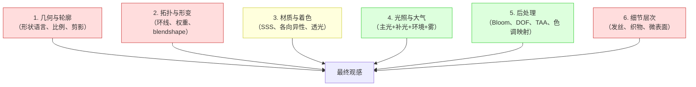
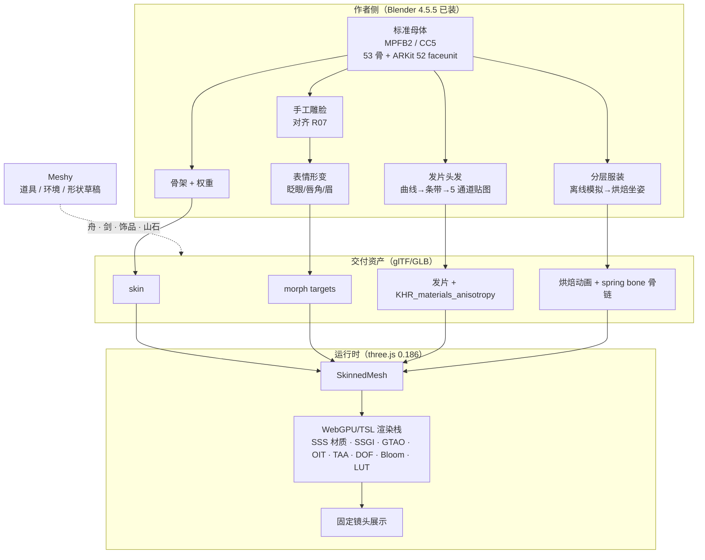

# 武侠人物高保真渲染：差距归因、技术选型与 Meshy 积分计划

调研与本地核验：2026-09-30。范围：东方武侠主题、网页端（three.js）实时展示、固定坐姿展示镜头。
状态：**技术调研与选型建议，未获得实施批准**。本文没有修改模型、没有调用 Meshy 收费接口、没有改动产品代码。

配套阅读：[模块化角色制作调研](modular-character-production-research.md)（制作管线与模块契约）· [头发工业调研](wuxia-hair-industry-research.md) · [真实 3D 首轮执行](wuxia-true3d-execution-2026-09-30.md) · [来源与费用附录](modular-character-research-sources.md)。

本文与上述文档的分工：既有文档回答「怎么把资产做出来、怎么分模块」；**本文回答「为什么现在看起来不像参考图」以及「渲染与表现技术栈该怎么选，Meshy 积分该往哪里花」**。

---

## 0. 结论摘要

1. **之前的失败不是"参数没调好"，而是资产类别错位。** 需要的是「可绑定、可换装、可表情的角色生产资产」，实际拿到的是「单一融合的静态三角网格」。我扫描了 `art/dual-theme/` 下**全部 41 个 GLB**，`skins / animations / morphTargets` **全部为 0**。这不是"还没做绑定"，而是**整个资产库从生成阶段起就不承载骨骼、表情和动画**。
2. **参考图是电影级单帧质感，实时网页里没有逐像素等价物。** 参考图每条发丝、每根织物纤维、皮肤次表面散射与景深，来自离线渲染管线。可达成的是「同一角色、同一构图、观感显著接近」（具体能达到几成取决于投入的工时，**这不是一个可以事先承诺的数字**），靠的是**标准母体 + 模块化拆件 + 发片头发 + ARKit blendshape + 烘焙次级运动 + 电影感后处理**，而不是继续从 AI 生成的三角网格里榨细节。
3. **Meshy 的正确定位是"道具与环境生成器 + 形状草稿机"，不是人物主资产来源。** 7000 积分应按这个定位分配：硬表面道具、环境、发型/服装的形状探索值得花；继续生成人物整体高模、对已绑定模型重贴图、指望 AI 出表情——已验证走不通。
4. **本项目现有的 three.js 0.186 本身就带着一套接近电影的渲染能力**（次表面散射材质、SSGI、SSR、GTAO、顺序无关透明 OIT、TAA、景深、Bloom、LUT 调色等，见 §3.7），且**无需新增任何依赖**。这是一条被严重低估的升级路径——"看起来贵"的一半来自渲染而非资产。
5. **神经渲染（3DGS）与 LoRA 都不是本项目的解**：前者需要多视角采集且原始实现为非商用许可，后者根本不能产出可绑定几何。LoRA 的真实价值在**给 Meshy 提供更一致的多视角输入图**，见 §5、§6。

### 0.1 立刻要做的三件事（都是决策前提，不需要花钱）

| # | 事项 | 为什么必须先做 | 怎么做 |
|---|---|---|---|
| 1 | **确认积分类型与重置日** | 决定这项工作有没有时间压力 | meshy.ai → Settings → Subscription，分别记下 **Monthly Credits / Permanent Credits / next reset date**（见 §8.1）。若主要是 Permanent，**就没有"快过期"这回事**，可以从容按探针→批量的节奏做 |
| 2 | **选定母体路线** | 决定质量天花板与总工时 | 许可这一关**本次已基本查清**（见 §4.4、§4.5）：MetaHuman 许可允许任何引擎使用、但无官方 glTF；CC5 无 glTF 直出；MPFB2 是 CC0。**推荐组合已给出（§4.4.1）**，需要你拍板的是"要不要买 $191.88/年的 FaceBuilder"和"接受多少人工工时" |
| 3 | **决定目标线：写实还原 vs 风格化** | 决定整体工作量，差距是数量级的 | 见 §7.0。此前所有失败都发生在"写实还原"这条最难的路上 |

> 这三件事都不涉及付费、不可逆操作或代码改动。**在它们有答案之前，不建议再追加任何 Meshy 建模任务或人物资产制作。**

---

## 1. 参考图要求的是什么：目标基线拆解

对 `art/dual-theme/eastern/references/` 中的 r01、r07、r08 与主参考 v2 逐项拆解。这张表是后续所有技术选型的判据来源。

| 维度 | 参考图呈现的效果 | 当前资产实际状态 | 差距性质 |
|---|---|---|---|
| 皮肤 | 次表面散射的通透感、颊部与鼻尖泛红、毛孔级微表面、真实鼻翼/唇珠结构 | 灰模平滑、4K 贴图后像"上色蜡像"；无次表面散射 | **渲染 + 几何**双缺口 |
| 眼睛 | 眼球几何 + 虹膜/瞳孔/巩膜分层 + 泪膜高光 + 真实睫毛 + 眼睑褶皱 | **眼睛是画在贴图上的**，无眼球、无睫毛、无眼睑环线 | **结构缺口**，不可修补 |
| 头发 | 发髻结构 + 束状分层 + 飞散碎发 + 各向异性高光 + 发梢透空 | 单一连续深色壳 + 三角碎片；v17 改发片后仍"前发脏乱、肩颈残片" | **表示方式错误** |
| 服装 | 3–4 层叠穿、纱料半透透光、刺绣纹样、金属护腕/腰饰/玉坠 | 一个融合 primitive；4K 重贴图后材质可辨认但"青绿色较淡、小纹样不精细" | **结构 + 材质**缺口 |
| 手与握持 | 分指结构、握剑接触自然、腕部过渡 | 无手指骨骼；blockout 仅"剑放在船上做比例审查" | **结构缺口** |
| 姿态 | 交叠腿坐姿、裙摆自然堆叠下垂 | blockout 中人物仍接近站立/倚靠，坐姿未成立 | **制作缺口** |
| 光照 | 暖逆光 + 冷补光 + 大气雾 + 浅景深 | 审查页是中性灰背景 + 三点光，无后处理 | **渲染缺口**，最易补 |
| 整体 | 电影级单帧 | 静态几何预览 | 逐像素等价**不存在** |

> **关键判断**：这张表里，"光照"和"渲染"两项是**低垂果实**——不改变任何几何，仅升级渲染栈就能显著提升观感。而"眼睛""手""头发""服装分层"是**结构缺口**，只能靠重新制作解决，无法通过减面/平滑/重贴图修补。

---

## 2. 历次尝试的问题归因（一手核验）

### 2.1 资产结构实测

我用本地脚本直接解析 GLB 的 JSON chunk 得到下表（**本机核验，2026-09-30**，非文档转述）：

| 资产 | 三角形 | mesh | primitive | **skins** | **animations** | **morph targets** | 材质 | 贴图 |
|---|---:|---:|---:|---:|---:|---:|---:|---:|
| `gray-v1` 原始母版 | 6,866,114 | 1 | 1 | **0** | **0** | **0** | 1 | 0 |
| `protected-textured-4k-v1` 4K PBR | 1,206,676 | 1 | 1 | **0** | **0** | **0** | 1 | 3 |
| `layered-hair-v17` 当前候选 | 855,110 | 1 | 2 | **0** | **0** | **0** | 2 | 7 |
| `face-priority-v8` 减面候选 | 66,238 | 1 | 1 | **0** | **0** | **0** | 1 | 0 |
| `wuxia-boat-review-v1` 舟 | 52,567 | 1 | 1 | **0** | **0** | **0** | 1 | 3 |

**四个事实**：① 没有任何一个资产有骨骼；② 没有任何一个资产有表情形变通道；③ 每个角色都是**单个 mesh、单节点**——头发、身体、衣服、饰品焊死在一个几何体里，**物理上无法换装**；④ v17 已经是当前最强候选，全项目仅用了 1 个材质扩展（`KHR_materials_anisotropy`）。

> **补强证据**：我扫描了 `art/dual-theme/` 下**全部 41 个 GLB 文件**，结果为 `withSkinOrAnimationOrMorph = 0`。
> **没有任何一个资产带骨骼、动画或表情通道。** 这不是"人物还没做绑定"，而是整个资产库从生成阶段就产出了同一类东西：静态、单一、融合的三角网格。

### 2.2 七个根因

| # | 根因 | 具体证据 | 为什么修补无效 |
|---|---|---|---|
| 1 | **资产类别错位** | 全部资产 `skins/animations/morphTargets = 0` | 从"单一静态网格"到"可表情可换装角色"之间没有连续路径；任何减面/平滑/重贴图都不会新增骨骼或 morph |
| 2 | **把"减面"当成了"制作游戏网格"** | v8 报告："仅重算法线的 v2 改善了一部分明暗，**但无法恢复已经删除的鼻、眼、嘴几何**" | **Blender 官方手册明确写着**：自动重网格工具 *"generally don't result in topology that lends itself to deformation"*，且 *"no perfect automatic tools exist for this right now; **it has to be done manually**"*。工业界**从不靠减面得到游戏内网格**——减面在管线里的位置是 **LOD 生成**，真正的做法是**重拓扑出边流正确的新网格 + 烘焙高模细节**。我们用工具做了它被明确告知做不到的事 |
| 3 | **头发的表示方式错误** | v14 自查："截面形成鼓起的整块体积；更高分辨率贴图不能改变侧面厚度" | 工业界的头发是**发束/发片 + 覆盖贴图 + 各向异性 + 骨链**，与"封闭网格壳"是不同的数据结构；加法线、加锐化、加发丝贴图都改不动轮廓 |
| 4 | **眼睛没有几何** | 对照图中眼睛是贴图；无眼球、无睫毛、无眼睑环线 | 没有眼球就不能眨眼，没有眼睑环线就不能做表情——这是 §3.5 的结构前提 |
| 5 | **AI 重贴图会改几何** | 4K retexture：1,216,304 面 → 1,206,676 面、**5 个 primitive 合成 1**、坐标 Y 归一化到 [-1,1] | 一旦绑定/分模块，就再也不能用 Meshy 重贴图；工作流被锁死 |
| 6 | **工作顺序颠倒** | 实际顺序：生成 → 减面 → 清理 → 局部重建发束 → 保护减面 → 重贴图 | 每一步都在为前一步的结构债付利息；正确顺序是**先定母体与绑定接口，再做可见细节** |
| 7 | **验证偏技术、缺美术判据** | 报告中大量 `0 errors`、`校验通过`、`哈希一致`，但"像不像 R07"从未被结构化为可执行检查 | 格式合法 ≠ 美术合格；当前缺的是**可复现的美术验收项**（同一镜头、同一光照下的形状/材质/发流对照） |

### 2.3 Meshy 官方的解释：我们的输入恰好落在它明确警告的那一类

这一节值得单独列出，因为它不是我的推断，而是**供应商自己的文档**在描述我们这个项目遇到的每一个症状。

Meshy 帮助中心《Fix Character Pose, Face, and Hand Issues》（2026-08-15）原文：

> "**Stylized and fantasy art styles**: Heavily stylized or fantasy characters produce more artifacts on hands, faces, **and thin features (weapons, accessories)** compared to photorealistic references. If your character uses a non-realistic style, **expect more variance between generations and plan for additional retouching**."

> "Faces can look flattened, asymmetric, or lack fine detail, especially at lower resolution settings or **with stylized/non-photorealistic references**."

> "Fingers may fuse together, appear too few/many, or clip through each other."

**对照我们的实际遭遇**：

| Meshy 官方警告 | 我们实际遇到的 |
|---|---|
| 风格化参考在手部、脸部产生更多伪影 | 面部"接近母版但不能承诺与 R01/R07 一致"；手指从未验收 |
| **细长物件（武器、配件）伪影更多** | 背发呈"块状/碎片感"、肩颈残片、发饰不精细——细长结构正是重灾区 |
| 同一输入多次生成结果差异大 | 项目确实反复重掷了 v1→v17 |
| 风格化要"计划额外的返修工时" | 项目实际投入了 17 版头发 + 多轮网格清理 |

**也就是说：我们选择的美术方向（厚涂半写实武侠），正好是 Meshy 官方标注为"最不可靠"的输入类型。** 这不是操作失误，而是**工具与目标不匹配**——用一个面向写实照片的生成器去还原一张风格化插画。

同时这份文档还给出了三条我们**没有用上**的正确做法：

| 官方建议 | 我们当时的状态 | 价值 |
|---|---|---|
| **Pose Control**：Image to 3D 工作区支持 A-Pose / T-Pose / **Custom Pose 关节调节**，可在生成前摆好姿势 | 我们靠提示词和参考图暗示坐姿，blockout 里人物仍接近站立 | **直接可用**：交叠腿坐姿可以在生成阶段就摆好 |
| **Multi-view**（正/侧/背）显著改善面部比例与手部几何 | 项目参考图集其实已有正/背/侧，但主要用单图 image-to-3d | **直接可用**：改用 multi-image-to-3d 有机会改善对称与背面对应 |
| **要绑定的角色必须用 A/T-Pose，且参考图中四肢不可交叠** | 参考图是"交叠腿坐姿 + 双手搭剑"——**官方点名的最差输入** | 解释了为什么绑定路走不通：需要**单独生成一个 A-pose 版本**专门用于绑定 |

> 最后一条尤其重要：**"坐着交叠腿持剑"这个姿势，从绑定角度看是无效输入。** 正确做法是生成一个标准 A-pose 的"绑定版"角色，绑定并调好权重后，再在 DCC 里摆成坐姿。

### 2.4 一句话归因

> **在错误的资产类别上做外观修补。**
> 需要的是「带骨架、带表情通道、头发/衣服是可替换模块」的生产资产；拿到的是「一个融合的静态三角网格」。前者可以在其上叠加渲染与动画；后者连"被渲染得有生命"的前提都不具备。

---

## 3. 渲染技术栈：业界怎么做到"看起来贵"，three.js 能到哪

### 3.1 一张角色"看起来写实"的公式

角色写实度不是单一技术，而是六个乘数叠加。任何一项接近 0，整体观感就塌：



红色项（1、2、6）是**结构与制作问题**，必须重做；绿色项（4、5）是**渲染问题**，可以立刻改善；黄色项（3）一半靠制作一半靠渲染。

### 3.1.1 「写实角色」在工业界的官方预算是多少

Epic 在 MetaHuman 官方文档《Platform Support and LOD Specifications》里直接公布了**一个写实数字人每个 LOD 需要多少顶点、骨骼、blendshape 和发丝**。这等价于 Epic 对"什么叫合格的写实角色"给出的官方答案：

| 部位 | LOD0 规模 | 说明 |
|---|---|---|
| **头部** | **24,000 顶点 / 669 blendshape / 713 关节 / 12 蒙皮影响** | 只有 LOD0 保留 blendshape |
| **身体** | **30,500 顶点 / 含 corrective shapes / 8 蒙皮影响** | 头部与身体是**两套独立 Skeletal Mesh** |
| **头发** | **50,000 根发丝**，或 **30,000 发片顶点** | LOD1 减半；LOD5 之后才退化为 mesh |
| **移动端（Epic 官方口径）** | 仅发片头发、LOD3、贴图上限 2048 | 连 Epic 自己都这样砍 |

三个必须看懂的结论：

1. **669 个 blendshape 对 ARKit 的 52 个。** 52 个只是"最低可用的表情接口"；一个真正写实的面部 rig 规模是它的 **10 倍以上**，多出来的全是 corrective shapes 与更细的肌肉/皮肤滑动。**本项目目前是 0 个。**
2. **写实角色根本不是"一个网格"。** 头、身体、头发、衣服在 Epic 的方案里从一开始就是分开的 Skeletal Mesh。**这从结构上反驳了"把整个人物做成一个融合网格"的路线。**
3. **Apple 的 ARFaceAnchor 那 52 个系数是跨厂商互通的事实标准**（VRM 的 expression preset、Ready Player Me 的命名都对齐它），因此选母体时应坚持 ARKit 命名。

**工时量级（推断，非官方数据）**：Epic / Unity / Autodesk 都不公布"一个 3A 主角多少人工时"。按各阶段反推，一个自制写实角色合计约 **50–150 人日**。这个数字的意义不是精确，而是让你知道：**这不是"调参任务"，而是美术工程。**

> 值得注意的对照：Epic 官方 MetaHuman 站点的宣传语是 *"Create photorealistic digital humans ... in minutes"*。业界唯一能"分钟级"得到写实数字人的方式，是**从预制参数化数字人库里装配**，而不是从零生成网格。这正是 §4.4 里"标准母体"路线值得认真评估的原因。

### 3.2 皮肤：写实感的第一来源是次表面散射

真实皮肤的写实感主要来自**次表面散射（SSS）**——光线在皮肤内多次散射后从邻近位置出射，造成耳廓、鼻翼、指缝的透红。缺少它，皮肤会呈现"塑料/蜡"质感，这正是当前 4K 版观感为"上色蜡像"的主因。

三条可选路径（成本递增）：

| 路径 | 做法 | 代价 | 适用 |
|---|---|---|---|
| **贴图近似** | 在 base color 里画死红润区域；用 `MeshPhysicalMaterial` 的 `sheen` 做边缘微光 | 0 运行时成本 | 中远景够用，近景会穿帮 |
| **材质级 SSS**（推荐起点） | 用 three.js 自带的 `MeshSSSNodeMaterial`，按灯光方向加一个透射项 | 需走 WebGPU/TSL 路径 | **皮肤与纱料** |
| **经典 WebGL SSS** | `examples/jsm/shaders/SubsurfaceScatteringShader.js` | 基于 Phong，不接 PBR/IBL | 若必须留在 WebGL |
| **全扩散 SSS** | 自建屏幕空间/预积分散射 | 工程量最大 | 近景特写 |

**本机核验（three.js 0.186.0 源码原文）**：

- `src/materials/nodes/MeshSSSNodeMaterial.js`——注释写明 *"an experimental extension of `MeshPhysicalNodeMaterial` that implements a Subsurface scattering (SSS) term"*，实现参考 GDC 2011《Approximating Translucency for a Fast, Cheap and Convincing Subsurface Scattering Look》，暴露 `thicknessColor / thicknessDistortion / thicknessAmbient / thicknessAttenuation / thicknessPower / thicknessScale` 六个参数。
- `examples/jsm/shaders/SubsurfaceScatteringShader.js`——**经典 WebGL 路径也有**，同样基于上述 GDC 2011 近似，但是通过改写 `meshphong_frag` 实现的，因此**不接 PBR/IBL**。
- `MeshPhysicalMaterial` 本身**没有 SSS 参数**（有 `thickness` / `attenuationDistance` / `sheen` / `transmission`，都是不同概念）。

> ⚠️ **命名陷阱（我实际踩到并纠正过）**：three.js 里 `SSSNode` **不是**次表面散射，而是 **Screen-Space Shadows（屏幕空间阴影/接触阴影）**；`SSAAPassNode` 是**超采样抗锯齿**。三个 "SSS" 含义完全不同，查资料时不要混淆。
>
> **诚实的边界**：上述两种实现都是**单次散射透射近似**，擅长表现耳廓/鼻翼/纱料的透光，**不等于影视级的多次散射**。对中远景人物足够，对贴脸特写会显得单薄。

#### 为什么说"这不是调参不够，是渲染方程里少了一整项"

三条互相印证的证据链，把这件事钉死了：

**① glTF 规范层面就没有散射。** 官方扩展原文：`KHR_materials_volume` —— *"**Scattering is not subject of this extension.**"*；`KHR_materials_transmission` —— *"infinitely-thin materials with **no refraction, scattering, or dispersion**."* 也就是说，**整个 glTF PBR 扩展体系里没有任何一个扩展能表达次表面散射**，其余六个（clearcoat / sheen / anisotropy / iridescence / dispersion / specular）全是"在基础 BRDF 之上叠一层"的增补。

**② three.js 的 `transmission` 走的是 Beer–Lambert 吸收，不是散射。** 源码逐字：

```glsl
vec3 attenuationCoefficient = -log( attenuationColor ) / attenuationDistance;
vec3 transmittance = exp( - attenuationCoefficient * transmissionDistance ); // Beer's law
```

即"光进入介质后**只会被吸收，不会被散射回来**"。**拿它做皮肤，得到的是果冻或玻璃，不是肉。**

**③ 连 Epic 自己都要分两档，且低档那档自己承认不能做皮肤。** Unreal 官方文档：

- 低档 `MLM_Subsurface`：*"intended for materials like **wax or jade**"*，且明确写着 *"the effect from this shading model is **lower quality** and cheaper than what would generally be used for **skin** rendering."*
- 高档 **Subsurface Profile**：*"for rendering **realistic skin**"*，且**基于屏幕空间**，并带一条硬工程约束——*"This method **requires Temporal Anti-Aliasing to display properly**."*

> **这条证据的分量**：连 Epic 都要靠"屏幕空间 + 必须开 TAA"才能把皮肤做对。而 WebGL 路径上（a）three.js 没有官方 SSS，（b）TAA 在 WebGL 里要自己搭 EffectComposer 管线、且在动态场景中容易产生鬼影。
> **所以"3D 皮肤不如 2D 厚涂脸"不是调参问题，是渲染方程里少了一整项。** 这也是为什么 §7.0 建议认真考虑"风格化"目标线——风格化可以合法地绕过这一项。

### 3.3 头发：为什么"发片"是 Web 端唯一现实解

工业界有两条路：**发丝级 groom**（Unreal Groom/Strands）与**发片（hair cards）**。前者质量上限最高，但需要专门的模拟、体素化、深度阴影与合成管线。

**本机核验**：在整个 `three@0.186.0` 包里检索 `strand|groom|hair` —— **0 命中**。three.js **完全没有发丝管线**，glTF 也没有对应的核心扩展。这不是"还没做"，而是当前 Web 3D 生态里**不存在**这条路径。**所以发片不是权宜之计，是唯一解。**

发片方案的本质：用**十到几十张弯曲的薄条带**，配合一张覆盖贴图（alpha 切出发丝缝隙）、一张法线贴图（假纤维起伏）、一张粗糙度贴图（控制高光宽度）、以及发流方向数据，在**极少几何**上表达"很多根头发"。

| 层次 | 几何职责 | 期望观感 |
|---|---|---|
| 内层 | 贴合头皮的薄遮挡层 | 发片间不露空洞，但不独占轮廓 |
| 主发束 | 宽窄不同的扁平束，独立导向曲线 | 正背面可读的束间分层 |
| 次发束 | 错位叠层与长短差异 | 光照移动时有层次，避免等距条纹 |
| 边缘／发尾 | 稀疏发片 + 覆盖贴图 | 轻薄、有间隙，避免统一圆弧封口 |

**工业界的官方定性（三条互相印证的一手来源）**：

- **EA Frostbite**：*"For real-time scenes, the **current standard in the game industry** is to use so-called hair cards… The **higher the number of meshes, the better the illusion**… but the more expensive the asset will be. Using hair cards is relatively cheap computationally, but reaching high quality in either rendering or simulation is difficult and can be **extremely time consuming** for the content creators."*
- **Epic**：*"Traditionally, hair created for use in real-time projects has been created using **card-based techniques**, or other similar approximations."*
- **Epic 自己的 LOD 机制**就是混合方案的证据：同一个 hair group 的不同 LOD 可在 **Strands / Cards / Meshes** 之间切换，其中 **Strands 只在高端平台可用，Cards 与 Meshes 全平台可用**。

**浏览器里的现实量级**（推断，无一手基准）：**发丝直渲 1 万–3 万根**约为桌面 60fps 上限；**发片 200–600 片几乎无压力**。另外 UE 官方给的发丝参考数字是 *"30Hz or higher… with a NVIDIA RTX-2090Ti for a human-like groom rendered at 1080p"*——**而且 UE 的 Strands 渲染只在 Windows (DX11/12/Vulkan)、macOS M2+/SM6、Linux、PS5/XSX 可用**，Cards/Meshes 才全平台。

反过来说一个**利空发丝方案的事实**：Frostbite 2019 年主演角色只用了**约 10,000 根发丝、25 点/根**；而且 EA 官方判断 *"authoring strand hair is **easier and much faster** than authoring hair cards"*。也就是说，**发片的"制作昂贵"恰恰是我们最缺的资源**——但因为没有浏览器发丝路径，这仍是必须付的成本。

> **两条重要提醒**：
> ① **发片不是"低配妥协"，而是业界标准做法**——但它的成本在**内容制作工时**上，不在运行时。Epic 官方坦言手工做发片"can be a difficult and time-consuming task"，其自动转换插件（Hair Card Generator）至今标注为 **experimental**。
> ② ⚠️ **专利风险**：学术界的 *Hair Meshes*（Yuksel et al., SIGGRAPH Asia 2009）项目页原文写着 *"Hair meshes are protected by **US and International patents**"*，其核心是商业软件 Hair Farm。**任何采用"hair mesh 结构生成发丝"的方案都有专利与商用许可风险**，选工具时要避开。

#### 头发的制作工具与 AI 现状

**本次调研最该评估的一项采购**：**HairTG-Cards 2**（Eyosido 的商业工具）——它能把 **Blender 的 hair curves 直接转成带 UV、朝向与可变面数的发片**。注意一个重要澄清：**"HairTG" 不是学术论文，而是这个商业工具**。

**AI 生成头发在 2026 年还不能用**，三条同时不利：

| 方法 | 许可 | 问题 |
|---|---|---|
| HairStep / HAAR / Neural Haircut | **CC BY-NC 4.0** | 非商用 |
| DiffLocks | 自定义 **Non-Commercial** | 虽 2.33 s/张、可导出 .blend/Alembic，但输出每发型 **~10 万根发丝** |
| HairFastGAN | MIT | 但它是 **2D 换发**，与 3D 无关 |

更关键的是 HAAR 论文**自己承认**：基于 2D 先验的方法 **"只能重建 outer shell，高度遮挡的头发结构无法重建"**——**这正是武侠发型的失败模式**（发髻 + 层叠长发 + 饰品遮挡）。

> 顺带纠正一个流传的说法：**"StrandDreamer" 在 arXiv / GitHub / 搜索引擎三方检索均为零命中，不存在。** 另有一条值得跟进但**无代码、无许可**的新工作：`HairCS`（hair cards → strands）。

**一条必经的格式约束**（Blender 官方手册原文）：

> *"Likewise, **curves and other non-mesh data are not preserved, and must be converted to meshes prior to export**."*

所以本项目的头发链路是固定的：**Blender hair curves → Convert/Mesh（发片）→ 烘焙贴图 → glTF → three.js**。hair curves **不可能**直接进 GLB。

#### 头发方案排序（投入由低到高）

| # | 方案 | 质量 | 制作成本 | 运行成本 | 许可 | 定位 |
|---|---|---|---|---|---|---|
| 1 | **实体发束网格 + `anisotropy`/`sheen` 材质** | 中 | 低 | 极低 | 无风险 | **保底基线** |
| 2 | **发片 + `alphaTest`(≈0.35) 或 `alphaHash` + 把发丝流向烘进 `anisotropyMap`** | 高 | **高（唯一瓶颈）** | 低 | 低 | 🏆 **推荐主路径** |
| 3 | 方案 2 + **500–5000 根"英雄发丝"**（前发/鬓角/碎发） | 很高 | 很高 | 中 | 低 | 观感升级项 |
| 4 | AI 生成发丝 | — | — | — | ⚠️ | ❌ 不建议（许可+工程+产物形态三条同时不利） |
| 5 | 浏览器内自研发丝 groom | — | — | — | — | ❌ 排除 |
| 6 | **Hair Meshes 结构** | — | — | — | 🚫 **美国/国际专利** | ❌ 法律红线，商用需联系作者 |

方案 2 的一个关键技巧（与 lilToon 的"異方性反射"页同构）：**把发丝流向烘进 `anisotropyMap` 的 RG 通道、强度放 B 通道**，材质可直接用 GLTFLoader 的 `KHR_materials_sheen` 与 `KHR_materials_anisotropy` **在 DCC 里调好再导出**。

**着色**：头发高光具有强各向异性。three.js 的 `MeshPhysicalMaterial` 提供 `anisotropy`（强度/旋转/方向贴图），glTF 侧对应 `KHR_materials_anisotropy`——**这两项当前项目都已在用**（v17 实测即使用该扩展）。但要注意：它是通用物理材质的近似，**不等于 PBRT 中完整的毛发纤维散射模型**；材质能改善高光，**不能修复厚轮廓**。

**透明的坑（这一条我最初判断错了，已更正）**：发片是 alpha 材质，会遇到排序错误、远景闪烁、阴影投出整片矩形黑影、以及大面积透明重叠带来的 overdraw。

我起初认为"three.js 有 `OITPassNode`（顺序无关透明），所以 OIT 是发片透明的正解"。**这是错的。** Unreal 官方对同类技术（Per-Pixel Linked List）的定性是：

> "This technique stores a long list of samples per pixel. This option is **very expensive and should only be used for linear media, and precomputed cinematics**."

而 Khronos 的 Vulkan OIT 官方样例也说明其**每像素最多排序 16 个片元**，超出只能"尽力而为"、结果可能不准，并且明确存在"性能与正确性的取舍"。**结论：OIT 对实时游戏画面不适用，对本项目应当排除。**

**工业界的实际做法是二选一**：

| 组合 | 说明 | 代价 |
|---|---|---|
| **`alphaTest` + MSAA/TAA** | 按阈值裁切，硬边但稳定；靠时间性抗锯齿收敛 | 边缘略硬 |
| **Dithered opacity + TAA** | 抖动决定片元去留，靠 TAA 收敛 | 单帧有噪声，**强依赖 TAA** |

three.js 的对应开关是 `alphaTest`、`alphaToCoverage`（依赖 MSAA，加入离屏后处理需确认渲染目标是否多采样）、`alphaHash`（抖动，正好配合 TAA）。

**推荐用 `alphaHash`**——three.js 维护者 donmccurdy 在官方论坛亲自推荐它，唯一缺点是引入噪点（正好由 TAA 收敛）。官方示例的配套写法是：

```js
material.alphaHash   = true;
material.transparent = false;   // 关键：不参与透明排序
material.depthWrite  = true;
```

（历史版本参考：`MeshPhysicalMaterial.anisotropy` 于 **r153** 加入；`sheen`/`sheenRoughness` 于 **r133**；`Material.alphaHash` 于 **r154**。本项目用的 0.186 全部具备。）

### 3.4 衣服：分层、透光与"飘动"的真实成本

参考图的服装是 3–4 层叠穿，其中纱料**半透明且透光**。这对应两种材质特性：`transmission`（折射透射）与 `sheen`（布料边缘散射）——**均已在本项目 three.js 中可用**（`MeshPhysicalMaterial` 实测支持 `transmission`、`thickness`、`attenuationDistance`、`sheen`、`clearcoat`）。

关于"衣服飘动"，必须先破除一个预期：**浏览器里跑完整布料解算不是一个可依赖的首版方案**。工业界对"固定镜头的确定性镜头"几乎一律用**离线模拟 + 烘焙**，对"游戏内实时角色"用**骨骼链/弹簧骨**近似。四条路径：

| 路径 | 原理 | 质量 | 运行时代价 | 本项目适配 |
|---|---|---|---|---|
| **离线模拟 + 烘焙** | Blender/MD 里模拟好，烘焙成骨骼动画或 morph 序列 | 最高 | 低（播放烘焙数据） | **推荐**：固定坐姿 + 6–10 秒循环。**Marvelous Designer 2026.0 已原生导出 glTF/GLB，导出面板直接带 `Garment Animation` / `Avatar Joint Animation` / `Bake Keyframes`**，"MD 做衣 → 烘动画 → 给 Web" 已是厂商一等公民 |
| **骨骼链驱动** | 裙摆/长袖挂 bone chain，用弹簧-阻尼跟随 | 中高 | 极低 | **推荐**：与上一条组合 |
| **实时布料求解** | 浏览器里跑 verlet/软体求解 | 中 | 高且不稳定 | 首版不建议 |
| **顶点着色器假布料** | 顶点位移 + 风场函数 | 低 | 几乎为零 | 作为叠加细节 |

VRM 的 **SpringBone 规范**是 Web 端最成熟的"抖动"方案，本项目可借鉴其参数模型（刚度、阻尼、重力、碰撞体），无论是否采用 VRM 格式本身。

#### 实测数据（子代理在本机 Node V8 上跑的基准）

| 方案 | 实测/官方数字 | 结论 |
|---|---|---|
| **`@pixiv/three-vrm-springbone` 3.5.5（MIT）** | **1000 个 joint = 0.0274 ms/帧** | **≈ 免费**，1 个角色的衣摆+头发远用不到 1000 joint |
| CPU verlet（three.js 式，12 次迭代，仅模拟） | 1024 顶点 1.86 ms / 2500 顶点 4.68 ms / 5041 顶点 9.50 ms / 10000 顶点 18.96 ms | **60fps 下 2500 顶点是上限**（还不含碰撞与回写） |
| three.js 官方 CPU 布料示例 | **r140 起已被删除** | 没有现成的可抄 |
| three.js GPU 布料（`webgpu_compute_cloth`，r180+） | 961 顶点，**必须 WebGPU**，源码内 WebGL backend 仍是 TODO | 新，且绑定 WebGPU 决策 |
| Rapier soft body | **2026-09-24 才随 Rapier 0.36.0 首发**（官方**确实支持 cloth soft-bodies**，我此前"只有刚体"的假设是错的），官方 blog 自认"首个版本可能有 edge case" | 能力存在，但**太新，不用于交付** |
| Jolt soft body（MIT / WASM） | 有 Cosserat rod、dihedral bend | 可用但工程量大 |
| Ammo.js（Bullet 2.82, zlib） | three.js r150–r186 一直保留 `physics_ammo_cloth` 示例（336 节点） | 最成熟的浏览器软体路径 |
| **NvCloth（BSD-3-Clause）** | **纯 C++，Web 不可用** | ❌ 排除 |

> **结论很干脆：这个场景不需要布料求解器。** "坐姿 + 固定镜头 + 轻微飘动"的正确实现是 **离线烘焙（衣摆主形态烘成骨链关键帧）+ spring bone（次级运动）**，前端依赖≈0、性能≈免费、结果确定可复现。

#### 一条来自 3A 的反直觉事实：连 Epic 也不在运行时算布料

Unreal 官方的 **ML Deformer** 的描述是：用**外部预生成的形变模拟数据训练一个模型**，运行时用 morph target 选择来**近似**高质量形变，从而 *"without the computational cost of real-time deformation generation"*。UE 5.5 发布说明把它的适用场景直接写成 **"muscle and quasi static cloth simulations"**。

> **也就是说**：参考图里那种"衣服随手部动作自然堆叠、肌肉随姿态变化"的细节，在 3A 里的实现方式**不是实时布料解算**，而是"**离线算好 → 训一个模型 → 运行时插值**"。所以本项目打算"不引入求解器"的决定，**与工业界的做法是一致的，不是偷懒**。

#### 一条容易被忽略的 glTF 硬约束

glTF 规范的动画通道**只允许 `translation / rotation / scale / weights`**。也就是说：

- **布料/头发的顶点级动画只能走 skin（骨骼）或 morph（形变）**，没有第三条路。
- `KHR_animation_pointer` **只能动画 asset 属性（材质、FOV），不能动顶点**——而且 **three.js 核心不支持它**（需 needle-tools 的第三方插件）。

这条约束反过来说明：**任何"库内直接跑布料求解"的方案，最终都必须转换成骨骼或 morph 才出得去**——那还不如一开始就用骨骼烘焙。

### 3.5 眼睛：写实角色最被低估的一环

参考图的眼神是"可读性"的关键。要做出可眨眼的眼睛，至少需要：**眼球球体几何**（可独立旋转）、**眼睑环线拓扑**（能闭合成缝）、**睫毛几何**（哪怕只是几片带 alpha 的条带）、以及眼球/虹膜/巩膜的分层材质。

当前资产**四项全无**。这一项无法通过渲染改善，只能重做——但它恰恰是"AI 生成人物"最典型的缺口，也是决定"像不像活人"的关键。在 §7 的路线图中，它是 G1 门槛的一部分。

### 3.6 后处理与镜头：最低成本的大幅提升

参考图的"电影感"有相当比例来自**后处理**而非资产本身：浅景深把背景化开、Bloom 让逆光溢出、色调映射统一影调、TAA 让发片边缘稳定。这部分**不改变任何几何**，是投入产出比最高的升级。

### 3.7 本项目 three.js 0.186 渲染能力实测清单

**这是本次调研最有操作价值的发现。** 本机 `apps/web` 依赖锁定 `three@0.186.0` + `@react-three/fiber@9.7.0` + `@react-three/drei@10.7.8`。核验其 WebGPU/TSL 后处理节点目录与实际材质能力：

| 能力 | three.js 0.186 实测状态 | 对本项目的意义 |
|---|---|---|
| **次表面散射（皮肤）** | ✅ `MeshSSSNodeMaterial`（TSL 材质，标为 experimental）+ ✅ `shaders/SubsurfaceScatteringShader`（经典 WebGL） | 皮肤摆脱"蜡像感"；两者都是 GDC 2011 透射近似 |
| **屏幕空间阴影（接触阴影）** | ✅ `tsl/display/SSSNode.js`（注意：**这是 Screen-Space Shadows，不是次表面散射**） | 发束、衣褶的细节暗部 |
| 全局光照 / 环境遮蔽 | ✅ `SSGINode`、`GTAONode`、`SSAONode` | 衣服褶皱、发束遮挡的立体感 |
| 屏幕空间反射 | ✅ `SSRNode` | 金属护腕、玉饰、水面 |
| 顺序无关透明 | ✅ `OITPassNode` | **发片透明的正解** |
| 景深 | ✅ `DepthOfFieldNode`、`BokehPass` | 参考图浅景深 |
| 运动模糊 | ✅ `MotionBlur`（TSL） | 电影感 |
| 时间抗锯齿 | ✅ `TRAANode`、`TAAUNode`、`TemporalReprojectNode` | 稳定细发丝边缘 |
| 抗锯齿 | ✅ `SMAANode`、`FXAANode`、`SSAAPassNode` | 基础画质 |
| Bloom / 泛光 | ✅ `BloomNode`、`UnrealBloomPass` | 逆光溢出 |
| 降噪 | ✅ `DenoiseNode`、`RecurrentDenoiseNode`、`BilateralBlurNode` | 配合 SSGI/SSS 减少噪声 |
| 色调映射 / LUT | ✅ `Lut3DNode`、`OutputPass` | 统一影调 |
| 各向异性（头发） | ✅ `MeshPhysicalMaterial.anisotropy` + `KHR_materials_anisotropy` | 已有使用 |
| 透射/半透纱料 | ✅ `MeshPhysicalMaterial.transmission/thickness/attenuationDistance` | 纱衣透光 |
| 布料边缘光 | ✅ `MeshPhysicalMaterial.sheen` | 织物绒感 |
| **`MeshPhysicalMaterial` 内置 SSS** | ❌ 无此参数 | 皮肤必须换用 `MeshSSSNodeMaterial` 或自定义 shader |
| **骨骼动画** | ✅ `SkinnedMesh` | 待资产具备 skin |
| **表情形变** | ✅ `morphTargetInfluences` | 待资产具备 morph |
| **IK 辅助** | ✅ `CCDIKSolver` | 握剑接触可做 |
| 几何/纹理压缩 | ✅ GLTFLoader 支持 `KHR_texture_basisu`、`EXT_meshopt_compression` 等（**需注册对应解码器**） | 10 MiB 首包目标的关键 |

> **重要架构判断**：上表里绝大多数高级效果（SSGI / SSR / GTAO / OIT / TAA / DOF / Bloom / LUT）**只存在于 WebGPU + TSL 节点路径**，经典 `WebGLRenderer` 拿不到（唯一例外是 SSS：经典路径有一个基于 Phong 的 `SubsurfaceScatteringShader` 可用，但不接 PBR/IBL）。
>
> 也就是说，**"要不要迁到 WebGPURenderer"是一个真实的分叉决策**。它的收益现在有**两条**，而不止一条：
> 1. **零新增依赖**地获得接近电影的后处理栈（上表）；
> 2. **获得 3DGS 支持**——three.js 的 `GaussianSplat` 与 `GLTFGaussianSplatLoaderExtension`（`KHR_gaussian_splatting`）**都要求 WebGPURenderer**（§5.3）。
>
> 代价是本项目渲染路径需要迁移。R3F 9.x 支持通过 `gl` 属性注入 `WebGPURenderer`，因此并非推倒重来。
>
> ⚠️ **但必须加上一条重要的降温**：three.js 官方**至今仍把 `WebGPURenderer` 标注为 "still in an experimental state"**，并且**仍以 `WebGLRenderer` 作为推荐默认**。"WebGPU 已经 stable"的说法**不成立**。所以这**不是一次"顺手升级"，而是采用一个官方自称实验性的渲染路径**——对本项目"主页要稳定可用"的定位，建议的做法是：**先做双路径对比小样，用实测帧时间和稳定性说话，而不是因为"新"就迁。**

**几条必须一起考虑的事实**：

| 事实 | 含义 |
|---|---|
| WebGPU 已于 **2025-11 在四大浏览器发布**（Chrome 113 / Firefox 141 / Safari 26） | 覆盖面比想象中好 |
| 但 **Linux 与 Android 的 Firefox 仍未默认开启** | 降级路径必须保留 |
| **`EffectComposer` 官方文档明文："This module can only be used with WebGLRenderer."** | **两条后处理栈不通用**——迁 WebGPU 意味着后处理代码要重写 |
| **WebGL 路径没有运动模糊**（`webgl_postprocessing_motion_blur` 实测 404） | 与上文"电影感"项冲突 |
| **WebGL 的 `TAARenderPass` 不是真 TAA**——官方注释自认 *"uses no reprojection so it is no TRAA implementation"* | **而 §3.2 已证明皮肤 SSS 依赖 TAA** → WebGL 路径上"皮肤 + TAA"这条路是断的 |
| `pmndrs/postprocessing` 6.39.5 | **没有 SSR、没有运动模糊、没有 TAA** |

> **综合判断**：这不是"WebGL 能不能凑合"的问题，而是**"写实皮肤"在 WebGL 上缺 TAA 这一环**。若走**风格化**路线（§7.0），则 TAA 与 SSS 的需求同时消失，**留在稳定的 WebGL 路径就是理性选择**。这又回到了同一个结论：**目标线的选择决定了技术栈的选择。**
>
> 补充一条正面信息：OIT 已在 three.js 落地（`OITPassNode`，Weighted Blended OIT，McGuire & Bavoil），但**同样只在 WebGPU 节点管线里**。

---

### 3.8 资产压缩：10 MiB 首包目标怎么达成（含一个必须避开的坑）

项目既有的"每主题首次 3D 传输 ≤10 MiB"目标，靠的是压缩链。关键数字（一手来源）：

| 项 | 数字 | 来源 |
|---|---|---|
| 顶点数据（相对已量化最优打包） | **2–4 倍** | meshoptimizer README |
| 索引 | 最好情况 **1 字节/三角形**（比 16 位索引小 **6 倍**），典型 1–1.2 B/tri | meshoptimizer README |
| meshopt 解码吞吐（浏览器 WASM SIMD） | **≈ 1 GB/s**；JS 解码器 1–3 GB/s | 规范 / js README |
| **KTX2 相对 PNG/JPEG 的显存** | **PNG/JPEG 可能多消耗 4–8 倍显存** | 官方文档 |

> **重要**：**下载体积小 ≠ 显存小。** 一张 4K RGBA8 解码后约 64 MiB，完整 mip 链约 85 MiB。PNG/JPEG 下载小，但**上传 GPU 时会被解成未压缩纹理**——这正是 KTX2 存在的理由。做首包预算时必须**分别统计"下载字节"与"显存占用"**。

另外两条与选型有关的事实：

- **Draco 官方从不公布压缩比，也不公布解码吞吐**（规范全文、README、官网、比特流规范四处均无数字）。任何"Draco 压缩到 X%"的说法**都必须标注为第三方**。对比之下 meshopt 有完整的官方数字。**glTF-Transform v4.0 起已把 optimize 的默认压缩方式从 Draco 改为 Meshopt。**
- `EXT_meshopt_compression` 的 fallback 机制要求父 bufferView 仍有合法引用；若不满足，**它必须是 required 扩展**——此时加载端**必须**提供解码器，否则**直接报错而不是回退**。启用前要确认解码器已注册。

#### ⚠️ 一个必须避开的坑：`gltf-transform optimize` 的 simplify 会毁掉 UV 与权重

从 glTF-Transform 源码逐字读出：`optimize` 的默认值是 **`--simplify` 默认 true**、`--simplify-ratio` 默认 **0.0**、`--simplify-error` 默认 **0.0001**。

更关键的一条技术事实：**它的 simplify 只把「位置」传给简化器**——源码中 `simplifier.simplify` 的入参**只有索引与位置数组**，**没有** UV、法线、颜色或权重，也**没有**调用 meshoptimizer 的 `simplifyWithAttributes`。

> **含义**：在一个**已经绑好骨骼、分好发片 UV** 的角色资产上直接跑 `gltf-transform optimize`，simplify 这一步会**按纯几何误差折叠边，完全无视 UV 接缝与蒙皮权重**——结果是贴图错位、权重错配。
>
> **正确做法**：对最终角色资产**显式关闭 simplify**（`--simplify false`），只保留量化和 meshopt 压缩；简化必须在 Blender 里、在你知道保护什么的时候做。这与 §2.2 第 2 条根因是同一个道理。

---

## 4. 可形变模型与表情：技术谱系

### 4.1 三条形变路线的取舍

| 技术 | 原理 | 优点 | 缺点 | 本项目适配 |
|---|---|---|---|---|
| **Blendshape / morph target** | 每个表情存一份顶点偏移，运行时按权重线性混合 | glTF 原生支持、three.js 原生播放、美术可控 | 顶点数 × 表情数 = 存储与显存；嘴唇/眼睑需要局部加密 | **主力**：情绪与眨眼 |
| **骨骼驱动面部 rig** | 用关节绑定面部 | 数据小、可程序化组合 | 需要极好的权重；写实度不如 blendshape | 辅助（下颌、眼球） |
| **校正形状 / pose-space deformation** | 按姿势查询修正形变 | 解决极端姿态穿模 | 需要 DCC 侧求解器，GLB 只能烘焙结果 | 坐姿裙摆修正 |

**关键事实**：glTF 2.0 规范原生支持 morph target，three.js 原生支持 `morphTargetInfluences` 播放。**也就是说，只要母体带着表情通道导出，网页端不需要任何额外技术就能做表情。** 缺的不是渲染能力，是**资产本身没有 morph**。

**这条链路已经被官方文档两头接上（一手核实）**：

- **Meshy 侧**：官方明确不做表情（§8.2），但能出网格与贴图。
- **Blender 侧**：Blender 4.5 LTS 官方手册写明其 glTF importer/exporter 支持 *"Animation (keyframe, **shape key**, and skinning)"*，Shape Keys 会导出为 morph targets。
- **three.js 侧**：原生播放 `morphTargetInfluences`。

> **即：「Meshy 出网格 → Blender 手工加 blendshape → 导出 GLB → 网页形变」这条链路在每一端都有官方保证。** 缺的只是人工投入。
>
> ⚠️ 一个容易踩的格式约束：**glTF 每顶点默认 4 根骨骼影响**（官方警告：非 4 或 8 的影响数会在很多查看器里显示错误）。本项目已有八权重试装适配路径，导出时需要对齐。

#### blendshape 的真实显存成本（本机读 three.js 0.186 源码算出）

three.js 用 `DataArrayTexture` 存储 morph target，**每个 target 占一层**，显存约为：

```
显存 ≈ 顶点数 × vertexDataCount × 16 字节 × target 数
```

顶点着色器是 `for (i < N) if (influence[i] != 0.0) getMorph(...)` —— **零权重会跳过取样**，所以每帧成本取决于「非零权重的数量」，不是 target 总数。另外 three.js **不校验** `MAX_ARRAY_TEXTURE_LAYERS`，超限时不会报错，只会静默出错。

实算（用于选型）：

| 场景 | 显存 |
|---|---|
| 15,000 顶点头 × 52 target（仅位置） | **≈ 12.5 MB** |
| 同上（+法线） | **≈ 25 MB** |
| 40,000 顶点头 × 52 target | **≈ 33–67 MB** |

> **结论**：桌面端跑满 52 个可行，移动端建议 20–25 个。但**本项目是距离 6.2–8.2 的固定中景**——**做 12–20 个 blendshape 的性价比远高于 52 个**。追求"全 52 个"是在为镜头根本看不清的精度付费。

glTF 侧还有几个必须知道的细节：morph 存的是 **delta**；**POSITION / NORMAL / TANGENT 必须支持**（TEXCOORD_n / COLOR_n 可选）；POSITION 的 delta **必须**带 `min/max`；**target 的语义名称只能放在 `extras.targetNames`**（非规范字段，但 three.js 的 GLTFLoader 会读它来生成 `morphTargetDictionary`，**不写就没有名字**，只能靠下标访问）。

### 4.2 ARKit 52 是事实标准

Apple 的 ARKit 定义了 **恰好 52 个**面部混合形状名称（官方 JSON 端点逐条数出：Left Eye 7 + Right Eye 7 + Mouth & Jaw 27 + Brow/Cheek/Nose 10 + `tongueOut` 1），值域 0.0–1.0。它已成为**捕捉侧的事实标准**（MediaPipe 输出 52；KeenTools 51；MPFB2 有 "ARKit style face units"）。采用它意味着**母体、动画、驱动三者可以来自不同厂商而仍然互通**。

> ⚠️ **但要小心一个常见误解**：**VRM 1.0 用的不是 ARKit 52，而是另一套 18 个预设**（happy/angry/sad/relaxed/surprised + aa/ih/ou/ee/oh + blink×3 + look×4 + neutral）。而且 VRM 规范自己承认程序化表情叠加会 *"The mesh may break"*，因此设了 `overrideMouth`/`overrideBlink`/`overrideLookAt` 三个覆盖开关。**两套标准之间需要一层映射**——选母体时要想清楚以哪套为主。

### 4.3 驱动方式

| 方式 | 技术 | 适用场景 |
|---|---|---|
| 预制动画 | DCC 里做表情动画烘焙进 GLB | **本项目首选**：呼吸、眨眼、微表情循环 |
| 摄像头实时 | 浏览器端人脸关键点 + blendshape 输出 | 非本项目需求 |
| 音频驱动口型 | 音频 → 口型权重 | 非本项目需求（人物不说话） |

对本项目的固定展示场景，**预制 + 程序化微动**就够了：呼吸（胸廓小幅起伏 + 衣物同步）、眨眼（眼球旋转 + 眼睑 morph）、微转头（身体骨架）、视线（眼球旋转）。不需要实时驱动。

#### ⚠️ 动作来源的一个硬约束：Mixamo 本项目用不了

项目既有文档把 Mixamo 列为可选的动作来源之一。**本次核实发现它对本项目有两重阻隔**（Adobe 官方 FAQ 原文）：

1. **"not available for users who have a country code from China"** —— 账号地区为中国则不可用。
2. **自动绑定明确写着 "large hair and clothing items may not work"** —— 飘逸长发 + 宽袍**正好是它点名会失败的输入**。

> **所以身体动作的来源要另找**：Blender 手工 K 帧、Meshy 的 `animate`/`text-to-motion`（**其骨架是 Mixamo 命名规范，所以两者生态其实是通的**）、或 Rokoko Studio（Starter 免费 / Basic 约 $10/月；Vision 每月 30 秒免费）。

### 4.4 可绑定母体方案横评

| 方案 | 有表情通道 | 有身体骨架 | 导出 glTF/GLB | 许可/价格 | 判断 |
|---|---|---|---|---|---|
| **MakeHuman / MPFB2**（Blender 插件） | ✅ 52 ARKit 命名 faceunits（"ARKit style face units"） | ✅ GameEngine 骨架（Unity Mecanim 100% 映射） | ✅ 官方 Blender glTF 导出器 | ✅ **核心资产 CC0，官方 FAQ 直说"可以卖"** | 🏆 **零许可风险的免费底座**，见下方推荐 |
| **KeenTools FaceBuilder for Blender** | ✅ **照片 → 51 个 ARKit-compatible blendshape** | 需配合底座 | 经 Blender 导出 | **$191.88/年**，明确可商用 | 🏆 **本次调研发现的最高战略价值工具**：能直接解决"把脸做成 R07 那样"这个最贵的一步 |
| Reallusion CC5 + Headshot 3 | ✅ | ✅ | ❌ **官方导出表只有 OBJ / FBX(含 rigging and morphs) / USD——glTF 出现 0 次** | CC5 **$299** / Deluxe $479 / Headshot 3 **$149–199** / 套装 **$329**；试用版不允许保存或导出；内容许可对应用内角色创建系统要求另行询问 Enterprise 条款 | 画质高、**官方支持 morph 导出**，但需 FBX 中转 |
| **MetaHuman（Epic）** | ✅ 影视级（LOD0 头部 669 blendshape） | ✅ | ❌ **无官方 glTF**；DNAViewer 只能"Create functional rigs for Maya / Export FBX" | ✅ **已核实**：官方许可页明确——**包含在 UE 标准许可内、年收入 <$1M 免费、可用于任何引擎或创作软件** | **法律上可用，卡在技术上**：需 FBX 中转，且会丢 RigLogic 行为层；另注 DNA-Calibration 仓库**不兼容 UE 5.6+ 创建的 MetaHuman** |
| VRoid / VRM | ✅ expression | ✅ humanoid | ✅ 原生 | 免费 | **风格是动漫向**，与半写实目标不符；但其 **springBone + expression 生态** 是 Web 端最成熟的参考 |
| Ready Player Me / Avaturn 等 SaaS | 通常提供 ARKit blendshapes | ✅ | ✅ | 按量计费 | 适合"用户自建 avatar"，不适合"特定角色的一次性精修" |
| ~~Ready Player Me~~ | — | — | — | — | ❌ **已停服**（DNS 核验：主域无 A 记录，docs/api/models/status 等子域全部 NXDOMAIN；Wayback 最后成功抓取 2026-03-17） |
| ~~Union Avatars~~ | — | — | — | — | ❌ **已停服**（官网现为域名停放页，下线窗口 2025-07 ～ 2025-11） |
| **Avaturn**（仍在运营） | ⚠️ **T1 体型更真实但完全没有表情能力；要表情只能用 T2** | ✅ | ✅ GLB（**不原生导出 VRM**） | **免费档拿不到 API**；PRO **$800/月含 1,000 个头像**，超出 $0.15/个 | ❌ 本项目是**单角色**，按头像计费的 SaaS 模型不适用 |
| 自动面部绑定服务（如 Polywink 类） | ✅ 由网格生成 blendshape | 需已有头 | 需核实 | 按件计费 | **值得评估的补丁**：可用于给"已经做好的头"补表情通道 |
| **FLAME / SMPL-X 等参数化可形变模型** | ✅ 学术界标准 morphable model | 需自建管线 | 需自建 | ⚠️ **版本差异关键**：FLAME 2017/2019/2020/2023 **禁商用**（官网《Academic Model License》原文：*"Software Copyright License for non-commercial scientific research purposes"*）；**只有 FLAME 2023 Open 是 CC-BY 可商用**。且 DECA / EMOCA / MICA 全部依赖 FLAME → 全部非商用（SMIRK 代码是 MIT，但模型仍跟 FLAME 走） | ❌ **默认不能商用**；要用只有 FLAME 2023 Open 或另行取得授权 |

> **关于"可形变模型"这个词**：它在学术语境里通常特指 FLAME / SMPL-X 这类**参数化统计模型**（用几百个 PCA 系数描述任意人脸/人体）。它们的价值是"任意人可控可动"，但**默认许可是非商用科研**。对本项目而言，**真正的"可形变模型"应该是我们自己在 Blender 里做的母体 + blendshape**——那才是我们能拥有、能商用的资产。

> **本项目当前状态**：MPFB 母体已经在本机生成过（`wuxia-base-mpfb-candidate-v1.blend`，53 骨 + 52 个 ARKit 命名 faceunit + 独立眼部资产），且**Blender 4.5.5 LTS 已安装**（`%LOCALAPPDATA%\Programs\BlenderPortable-4.5.5`）。这意味着门槛不是"要不要买软件"，而是**要不要投入人工把脸雕成 R07**。

### 4.4.1 本次调研推荐的组合

综合许可风险、成本、画质与本项目镜头，推荐如下组合（不是三条路线的二选一，而是**取各自的强项**）：

```
MPFB2（CC0 底座，零许可风险，免费）
   + KeenTools FaceBuilder（$191.88/年，明确可商用）
        → 从 R01/R07 参考照片得到「像参考图的那张脸」
        → 输出 51 个 ARKit-compatible blendshape
   + 只保留 12–20 个 blendshape（不是全 52）
   + 程序化驱动（自动眨眼 + 呼吸）
   ↓
Blender 4.5.5 导出 GLB → three.js 原生 morphTargetInfluences
```

**为什么是它**：许可**零风险**；年成本 $0–192；15,000 顶点 × 20 target 仅约 5–10 MB 显存；且**镜头距离 6.2–8.2 的中景根本看不清 52 个表情通道的差别**。

**三条路线各自的真实短板**（都已核实）：

| 路线 | 真实短板 |
|---|---|
| **A. MetaHuman** | 法律上没问题，**卡在技术上**——无官方 glTF，需 FBX 中转，且中转会**丢掉 RigLogic 行为层**（那正是它表情好的原因） |
| **B. CC5 + Headshot 3（$329）** | 官方支持 morph 导出，但**导出表里没有 glTF**；且内容许可对"应用内角色创建"要求另行询问 |
| **C. MPFB2（CC0）** | 免费、零风险，**画质稍逊**——所以用 FaceBuilder 补脸 |

> **无论选哪条，Meshy 积分都帮不上脸。** 把积分花在头发、服装、小舟、湖面这些资产上。

### 4.5 待核实的许可门（必须在动手前解决）

本节原列为"待核实"，**本次调研已经查清了前两项**，记录如下：

| # | 问题 | 核实结果 |
|---|---|---|
| 1 | MetaHuman 能否在 Unreal 之外网页商用 | ✅ **可以。** 官方许可页明确：包含在 UE 标准许可内、**年收入 <$1M 免费**、**可用于任何引擎或创作软件**。真正的障碍是**技术性的**——无官方 glTF 导出（DNAViewer 只提供 Maya rig 与 FBX 导出），且 FBX 中转会丢掉 RigLogic 行为层 |
| 2 | Reallusion 对"网页端换装"是否另收 Enterprise 条款 | ⚠️ **仍未完全澄清**，但已查清导出能力：官方导出表只有 **OBJ / FBX(含 rigging and morphs) / USD**，**glTF 出现 0 次**。许可侧对"应用内角色创建系统"仍要求另行询问 |
| 3 | 各方案导出 glTF 后能否保留 blendshape 与骨架 | ✅ **能。** Blender 官方手册写明 glTF 导入导出支持 *"Animation (keyframe, **shape key**, and skinning)"*；Meshy→Blender→GLB→three.js 这条链路每一端都有官方保证（见 §4.1） |

**仍然未澄清的**：Reallusion 的换装授权细则；RPM / Union Avatars / Mixamo 的当前条款（本次调研环境被 TLS 与 Akamai 阻断，未核实）。

---

## 5. 神经渲染 / 3D 高斯泼溅：能不能用

### 5.1 它是什么

3D Gaussian Splatting（3DGS）用数百万个各向异性高斯椭球显式表达场景，通过光栅化实时渲染，能重建出照片级的真实感。它在**静态场景重建**上已经非常成熟，也已经有浏览器实现。

### 5.2 四条硬约束（均已一手核实）

| 约束 | 核实结果 | 对本项目的含义 |
|---|---|---|
| **输入要求** | 高保真 3DGS 人像需要**多视角**采集（多相机阵列或环绕视频） | 我们只有 2D 插画，没有多视角素材 |
| **许可（关键）** | 原始 3DGS 实现（INRIA）许可原文：*"The Software may be used **'non-commercially'**, i.e., for research and/or evaluation purposes only."* 且 *"THE USER CANNOT USE, EXPLOIT OR DISTRIBUTE THE SOFTWARE FOR COMMERCIAL PURPOSES WITHOUT PRIOR AND EXPLICIT CONSENT OF LICENSORS."* 更麻烦的是 §4.2 规定**非商用限制传染给衍生作品**。该许可**同时覆盖官方光栅化器 `diff-gaussian-rasterization`**，而几乎所有 3DGS 头像工作都依赖它 | **基于 INRIA 训练链的管线不能商用。** 但有干净的绕法：**训练端换 Apache-2.0 的 `nerfstudio-project/gsplat`**；**渲染端本来就是宽松的**（Spark / GaussianSplats3D / gsplat.js 都是 MIT） |
| **可变性** | 可表情的神经头像几乎全部非商用：`GaussianAvatars` 为 **CC BY-NC-SA 4.0**；`SplattingAvatar` **无 LICENSE 文件**；`3DGS-Avatar` 虽是 MIT 但依赖 SMPL 与 INRIA 光栅化器。且它们**都依赖 FLAME / SMPL-X**（研究许可） | 与"商用 + 可换装 + 可绑骨骼 + 浏览器加载"多重需求冲突 |
| **浏览器集成** | three.js 0.186 **自带 `GaussianSplat.js`**，但其文档原文写明：*"this class **can only be used with WebGPURenderer**. The `forceWebGL` fallback of WebGPURenderer is supported, but WebGLRenderer is not."* | 若继续用 R3F 默认的 `WebGLRenderer`，**three.js 官方 splat 路径用不了**。**但 MIT 的替代品不需要 WebGPU**：`Spark`（World Labs，`@sparkjsdev/spark`，**WebGL2**，能在同一管线里融合 mesh 与 splat，且支持骨骼动画）、`GaussianSplats3D`（MIT）、`gsplat.js`（MIT） |

### 5.2.1 ⚠️ 一条会直接推翻常见想法的判断：**splat 不能凭空增加细节**

这是本轴最有价值的结论，值得单独强调：

> **3DGS 是"重建"表示，不是"生成"表示。** 它的官方训练入口吃的是**实拍多视角照片**（COLMAP 数据集）。
> **把你现有的 Meshy 网格渲染成多视角图再去训 3DGS，只会重编码网格里已经有的信息量——不会长出新的发丝和五官。**

所以"用 3DGS 给现有模型加细节"这条路**在逻辑上就不成立**。要让 splat 真正带来厚涂级细节，前提是**先有"含这些细节且视角一致的图"**——而这恰恰是 LoRA 做不到、需要专门多视角采集或专门的多视角 diffusion 才能提供的输入。

**体量与性能参考**（供判断可行性）：

| 指标 | 数值 |
|---|---|
| 单 splat 体积 | 未压缩 PLY **232 B**（球谐占 192 B）；压缩 PLY 16 B；SPZ ≈ PLY 的 1/10；`.splat` 32 B |
| 30 万 splat 的角色 | PLY ≈ 70 MB / SPZ ≈ 7 MB / SOG ≈ 4–5 MB |
| 渲染上限（GaussianSplats3D 官方） | SH0 ≈ 1600 万 / SH2 ≈ 800 万 splat（排序在 CPU，移动端官方自陈 sub-optimal） |
| 实测量级 | SplattingAvatar：300 FPS 桌面 / **30 FPS 移动端**；TaoAvatar：Vision Pro 90 FPS |

> 对照本项目的 **10 MiB 首包目标**：30 万 splat 压缩到 SPZ 约 7 MB——**装得下，但只能装一层**，不可能既装全身 splat 又装网格与动画。

### 5.3 一条值得注意的新路径：mesh + splat 混合

**`KHR_gaussian_splatting` 已被 Khronos 正式批准**（状态原文 "Complete, Ratified by the Khronos Group"，2026，CC-BY-4.0），它把高斯的位置/旋转/缩放/不透明度/球谐系数定义在 point primitive 上，**可以优雅降级为点云**。

这意味着一条此前不存在的标准路径：**同一个 .glb 里，角色主体是常规 mesh + 骨骼 + blendshape（负责一切形变与表情），而头发/衣物的微观细节用 splat 表达。** 主体可动可换装，细节保留照片级真实感。

**本机核验：three.js 0.186 已经能加载这条路径。** `examples/jsm/loaders/GLTFGaussianSplatLoaderExtension.js` 是一个 GLTFLoader 插件，其 `EXTENSION_NAME = 'KHR_gaussian_splatting'`，并解析 `KHR_gaussian_splatting:SCALE / ROTATION / OPACITY / SH_DEGREE_n_COEF_m` 等属性。**但它的文档同样注明 `requires WebGPURenderer`。** 同版本还带 `GaussianSplat`、`SPLATLoader`、`SPZLoader`、`KSPLATLoader`、`GaussianSplatPLYLoader`、`GaussianSplatUtils`。

不过对本项目，这条路目前**不推荐作为首版**，理由有三：① 训练侧许可仍未解决；② 需要 WebGPU 路径；③ 我们根本没有多视角素材去训练 splat。**但值得列入"如果目标真的是照片级，这是唯一有标准支撑的混合方向"**。

### 5.4 判断

**3DGS 不适合作为本项目主线**，理由按重要性排序：

1. **它是重建表示，不能凭空生成细节**（§5.2.1）——这是最根本的一条。
2. **我们只有单张 2D 插画**，没有多视角采集；可表情神经头像**没有一个支持单图输入**。
3. **可表情的神经头像没有一个可商用**：`GaussianAvatars` 是 CC BY-NC-SA 4.0；`SplattingAvatar` 无 LICENSE 文件；`HHAvatar` 明确**禁止用于 web services 与 games**；`FlashAvatar` 代码是 MIT 但数据受 FLAME 约束。
4. 2026 年确实出现了单图可动头像的论文（SplitAvatar、OMG-Avatar、OMEGA-Avatar 等），但**逐个查证均无官方代码**，且都在真人头数据集上训练，对厚涂插画角色属**分布外**。

**合理的定位**：不作为角色主体；若未来愿意为脸部/头发拍摄多视角素材，可作为**细节层**（用已批准的 `KHR_gaussian_splatting` 装进同一个 .glb），渲染端用 MIT 的 Spark，训练端避开 INRIA。**但这是后话，不是首版路径。**

---

## 6. LoRA 的真实定位

### 6.1 LoRA 是什么

LoRA（Low-Rank Adaptation）是一种**对大模型做低秩微调**的技术：冻结原模型权重，只在旁路注入小秩矩阵，从而用极少参数让模型学会新概念或新风格。它诞生的场景是 **diffusion 图像模型与 LLM 的微调**。

### 6.2 它不能做什么（必须说清）

> **LoRA 不能产出可绑定、有表情的 3D 角色。**

原因很直接：LoRA（2021 年 Microsoft 提出的 LLM 低秩适配方法：冻结原权重、只插入低秩分解矩阵）微调的是"生成 2D 像素"或"生成 token"的模型，它的输出是**二维图像**或**文本**，不含拓扑、不含 UV、不含骨骼权重、不含 blendshape。把它当作 3D 生成方案是概念错位。

在 3D 生成领域，LoRA 的**对应物**（给多视角 diffusion / DiT——如 TRELLIS 的 rectified flow transformer、Hunyuan3D 的 DiT——做低秩微调）作用域是**风格与材质先验**，同样**不产出骨骼、blendshape 或可用拓扑**。

### 6.3 它在本项目里真正的价值

**价值点在输入端，不在输出端。** Meshy 的 image-to-3D 输出质量上限**由输入图决定**。当前项目已经在用"用户自制主参考图"作为输入——这正是对的方向。LoRA 能让这个环节更强：

| 用途 | 具体做法 | 收益 |
|---|---|---|
| **角色一致性** | 用 10–30 张同一角色的图训练 LoRA，稳定生成"同一个人的不同角度" | 解决 AI 图生 3D 最痛的"多视角不一致"问题 |
| **多视角参考图** | 生成正面/背面/侧面/三分之四的一致图，作为 `multi-image-to-3d` 的输入 | 可能改善几何一致性与背面对称性 |
| **风格与材质素材** | 生成刺绣纹样、织物纹理、发丝贴图素材 | 喂给贴图制作环节 |

**但要注意**：生成的图仍是 2D 插画，**不能替代 §3.5 的眼睛几何、§3.3 的发片结构**。它改善的是"输入更好"，不是"输出变成生产资产"。

### 6.4 与"3D 生成里的 LoRA-like 技术"的区分

多视角 diffusion（Zero123、SV3D 等）与 3D 原生生成模型（TRELLIS、Hunyuan3D、TripoSG 等）常被混称为"3D 的 LoRA"，但它们是**几何/多视角生成器**，不是适配器。**许可逐条核实后，坑比想象的多**：

| 模型 | 许可核实结果 |
|---|---|
| **Zero123** | 代码 MIT，但权重卡片的正文写 "research only"，**与自己标的 mit 自相矛盾** |
| **SV3D** | 权重是 **STABILITY AI NON-COMMERCIAL COMMUNITY LICENSE**——**无收入门槛，直接禁 production use** |
| **TRELLIS**（微软） | 主体 MIT，但子模块 `diffoctreerast` 是 **INRIA 非商用衍生**；只走 mesh/GLB 路径可主张干净 |
| **Hunyuan3D 2.x**（腾讯） | **排除 EU / UK / 韩国**；MAU > 100 万需授权；且 §5.b **禁止拿输出改进其他 AI 模型**；§6.d 输出归使用者 |
| **InstantMesh** | Apache-2.0（但默认只出顶点色） |
| **TripoSG** | MIT（纯几何，无贴图） |

**这一整类都不产出骨骼或 blendshape**，且自建生成管线在成本上远不如直接买 Meshy。**结论：这条线对本项目不划算。**

---

## 7. 推荐方案

### 7.0 先谈一个更根本的问题：目标本身要不要调整

在选技术路线之前，必须先承认一件事：**参考图是"厚涂写实"风格，而写实是最不容错的美术方向。** 写实角色里，头皮露一点、发丝糊一点、皮肤少一点次表面散射，观众立刻觉得"假"；而**风格化**角色天然容忍这些缺口，甚至能把缺口变成设计语言。

这是三条可选的目标线，成本差距是数量级的：

| 目标线 | 表现 | 对本项目的含义 | 成本 |
|---|---|---|---|
| **写实还原参考图** | 逐项逼近 r01/r07/r08 | 需要全部 §3 六项乘数都接近满分 | 最高，且实时 Web 有天花板 |
| **"厚涂风"风格化写实**（推荐评估） | 保留参考图的人物设定与配色，但采用更集中的光比、更少的微表面依赖、明确的造型剪影 | 允许发片替代发丝、允许近似 SSS、允许较少的布料层 | 中，**且更可能在浏览器里做到"好看"** |
| **NPR 动漫向** | 卡通描边 + 平涂 | 与参考图气质偏离较远，但工程最稳 | 最低 |

**为什么风格化不只是"少做点"，而是真的绕开了问题**：VRM 的 **MToon** 规范采用硬分界光照模型——`shadingToonyFactor` 默认为 **0.9**，也就是亮部与暗部之间的过渡区**只有 10%**。

> **硬分界不暴露中间灰度，而中间灰度恰恰是所有渲染误差显形的地方。** 缺少 SSS、头发 BRDF 不对、布料没解算、置换不足——这些缺陷全部表现为"中间调不自然"。把过渡区压到 10%，等于**把误差显形的区域直接删掉**。

再叠加本项目的镜头条件——**固定镜头 + 受限轨道（±8° / ±6° / 距离 6.2–8.2）**，本质上是近乎静态的展示镜头。这意味着：

| 写实路线的四项根因 | 风格化后 |
|---|---|
| 皮肤缺次表面散射 | ✅ 硬分界不需要连续过渡 |
| 头发缺发丝级 BRDF | ✅ 高光被简化成色块 |
| 布料无实时模拟 | ✅ 褶皱可用造型与法线表达 |
| 几何细分不足 | ✅ 不追求微表面 |

**结论：转风格化是本项目成本最低、成功率最高的一条路，而且它是一个美术方向决策，不是技术优化。**

**关键提醒**：项目此前所有失败，都发生在"写实还原"这条最难的路上。如果目标是让**主页好看、有辨识度、承载产品气质**，那么把目标从"还原这张图"调整为"用这张图的人物设定做一套风格化表现"，会让成功概率显著上升——**而且这不是妥协，是美术方向的选择**。

本节后续的方案 A/B/C 都建立在"仍要尽量写实"的前提上；如果采用风格化目标，工作量可以整体下调一档。

### 7.1 三条候选路线对比

| | **A：现有高模重拓扑** | **B：标准母体改型**（推荐） | **C：固定坐姿展示资产**（回退） |
|---|---|---|---|
| 做法 | 保留 Meshy 高模，人工补隐藏身体、重做眼口环线、蒙皮、重建头发衣服 | 用 MPFB2/CC5 类母体，改脸对齐 R07，重做衣发 | 只做一个镜头能看到的，预制衣裙褶皱，不做通用换装 |
| 相似度 | 最高（保已认可的脸） | 高（需人工对齐） | 高 |
| 可换装 | 差 | ✅ | ❌ |
| 可表情 | 可行但昂贵 | ✅ 母体自带 | 有限 |
| 工时 | 17–42 人日 | 13–34 人日 | 最低 |
| 风险 | 拓扑债难还 | 许可与脸型对齐 | 不可扩展 |

**推荐 B 为主线、A 为身份保真对照、C 为可交付回退**——与既有《模块化角色制作调研》结论一致，本文补充的是**渲染与表现侧的落地方式**。

### 7.2 推荐架构



### 7.3 阶段门禁

| 阶段 | 产物 | 通过标准 |
|---|---|---|
| **G1 头与表情** | 母体 + 对齐 R07 的脸 + 52 blendshape | 同一镜头下与 R07 正/三分之四视角可接受；**闭眼、张嘴、微笑三态成立** |
| **G2 一束头发** | 12–20 主发束 + 40–100 发片 + 完整材质 | 正/背/侧/逆光下无旧碎片；转头发根稳定；深浅背景无整片闪灭 |
| **G3 服装与坐姿** | 分层衣装 + 交叠腿坐姿 + 握剑接触 | 裙摆堆叠自然；手与剑接触不漂移；呼吸时衣不入肉 |
| **G4 循环与渲染** | 6–10 秒呼吸/眨眼/微动循环 + 后处理栈 | 循环首尾不跳；60fps 目标实测；首包 ≤10 MiB 目标 |
| **G5 主页接入** | 独立审查页 → 主页 | 失败降级可用；减少动态效果生效；业务 HTML 独立可操作 |

**每个阶段都不得跳过**：G1 不过就不要做 G2 的完整头发——这是本次归因里"顺序颠倒"的直接教训。

---

## 8. Meshy 7000 积分计划

### 8.1 先纠正一个前提：积分"过期"的说法需要拆开看

Meshy 帮助中心把积分分成两类，规则完全不同：

> "There are two types of credits, monthly credits and permanent credits. **Monthly credits reset every month**, whereas permanent credits do not expire. However, permanent credits that you purchase can only be used on a paid plan."
> —— Meshy Help Center《Do Credits Have an Expiration Date》

| 类型 | 来源 | 是否清零 | 附加限制 |
|---|---|---|---|
| **Monthly Credits** | 订阅套餐月额度（Pro 1,000 / Premium 3,000 / Ultra 10,000 / Studio 4,000 每席位） | **每月重置回套餐上限**，未用完不结转 | 无 |
| **Permanent Credits** | 单独充值包 + 官方奖励 | **永不过期** | 必须在**付费订阅期内**才能使用 |

消耗顺序为：免费月额度 → 订阅月额度 → 永久积分（永久积分**最后**才动）。

**因此"7000 积分即将过期"这个前提需要先被证实或证伪。** 真正会损失的只有 Monthly Credits（在重置日归零），Permanent Credits 可以慢慢来。

> **动手前必须先做的一件事**：登录 meshy.ai → Settings → Subscription，分别读出 **Monthly Credits** 与 **Permanent Credits** 两个数字，以及 **next reset date**。
> - 若 7000 主要是 **Monthly**：确实有截止日期，按 §8.5 在重置日前落地任务。
> - 若 7000 主要是 **Permanent**：**没有时间压力**，可以按 P0→P4 的节奏稳健推进，先做探针再批量。
> - 若是混合：优先把 Monthly 花在 P1/P2（道具与环境，一次成功率最高），Permanent 留给 P3/P4（需要试错的探索性任务）。

### 8.2 Meshy 的真实能力边界（本机 CLI 一手枚举）

本机 `meshy-cli 0.3.0`（最新 0.4.0）的 `meshy resources` 完整端点清单与关键约束：

| 端点 | 能力 | 关键约束（CLI 原文） | 本项目用途 |
|---|---|---|---|
| `text-to-3d` | 文本 → 3D | 两阶段 preview → refine | 形状草稿 |
| `image-to-3d` | 单图 → 3D | standard 或 **smart-topology 低模** | 道具主路径 |
| `multi-image-to-3d` | 多视角 → 3D | **beta**；官方建议优先用 image-to-3d | 谨慎试验 |
| `remesh` | 重网格/改面数 | — | 道具优化 |
| `convert` | 仅换格式 | — | 交付格式 |
| `resize` | 缩放到真实尺寸 | — | **道具尺寸对齐**（很实用） |
| `rigging` | 人形自动绑定 | **输入 GLB 必须 < 300k 面**，"remesh to ~10000 first if denser"；**不含面部/表情** | 有限用途，见下 |
| `animate` | 给已绑定角色套用动作 | 动作取自官方动画库 | 身体动作起点 |
| `retexture` | 重做贴图 | **会改变几何**（已实测） | 仅用于未绑定的资产 |
| `text-to-image` | 2D 图生成 | — | 概念素材 |
| `text-to-motion` | 文本 → 独立骨骼动作片段 | Prime 出 FBX，Swift 出 BVH | **动作探索**，需重定向 |
| `image-to-image` | 2D 图编辑 | — | 参考图变体 |
| `uv-unwrap` | **为 GLB 生成全新 UV** | **≤ 40k 面**；输出"UV 白模供外部贴图"；⚠️ 官方为灰度开关，**可能直接 404** | **新兴高价值能力**，见 §8.5 |
| `animation-catalog` | 公开动画库 | 无需 key | 动作选型 |
| `inspect` | 本地面数闸门检查 | 本地 | 提交前预检 |
| `balance` | 余额查询 | — | 日常核对 |

**结构性结论**：Meshy 的绑定是**双足人形身体骨架**，输出 GLB/FBX 并**附赠走路/跑步动画**，但**没有任何面部绑定、blendshape 或表情能力**。官方 Rigging 文档 FAQ 原文：

> "Can I rig a model for facial expressions or tail physics? — **Not directly** — for complex custom skeletons, export the model and rig manually in a DCC tool like Blender or Maya."
> —— Meshy Rigging 文档 FAQ

Animation 文档同样把"需要带面部表情的电影级精确动画"指向"Maya/Blender 手工制作"。交叉验证：对 Meshy 官方 openapi.yaml（115 KB、51 个 path）全文检索 `blendshape|morph|facial|face_rig|jaw|expression|finger|viseme` —— **0 命中**；`RiggingRequest` 仅有 `input_task_id / model_url / height_meters / texture_image_url` 四个字段。

**所以"用 Meshy 做出有表情的角色"这条路不存在，花多少积分都买不到。**

### 8.2.1 三条容易被忽略、但会直接改变工作流的官方约束

| 约束 | 官方原文要点 | 对本项目的含义 |
|---|---|---|
| **自动绑定上限 300,000 面** | "models with more than 300,000 faces are not supported for rigging"；且**只接受 .glb、必须带贴图、角色必须面朝 +Z** | 当前 855k 面的 v17 **必须先 Remesh**；而 Remesh 正是已证明会毁掉五官的那一步——**进一步印证"不要指望 Meshy 绑定救人物"** |
| **骨骼使用 Mixamo 命名规范** | 官方绑定输出按 Mixamo 骨骼命名 | **好消息**：Mixamo 生态的动作可直接复用，身体动作来源比预想的多 |
| **几何漂移是管线行为，不是 bug** | 上传规范写明 "If the file contains multiple meshes, they will be merged after uploading" + "the model needs to be centered at world origin" | 我们观测到的"5 primitive 合并成 1 + 坐标归一化"正是这两条规则的必然结果。**"不要对已绑定模型重贴图"的纪律因此被确认为正确** |
| **API 资产只保留 3 天** | 官方资产保留策略：API 生成的结果自动删除 | 批量跑任务时必须**立即下载**，否则积分白花 |

### 8.2.2 积分口径：Web 端与 API 不同价（可能省下一大笔）

官方两处文档给出的口径**明显不同**：

| 操作 | API 积分 | Web App 积分 |
|---|---:|---:|
| Remesh | 5 | **0** |
| Rigging | 5 | **0** |
| Animation（每个 clip） | 3 | **0** |
| Image to 3D（Meshy 7） | 20（Ultra +5） | 25 / 20（两处文档口径不一） |
| Text to Motion | prime 10 / swift 3 | 3 |

> **可操作结论（建议先实测验证）**：如果 Web 端的 Rigging / Animate / Remesh 真的是 0 积分，那么**"身体绑定 + 套动作 + 减面"应该全部在 Web 端做**，API 只用来付费生成几何与贴图。一个角色绑定 + 8 个动作，API 要 5 + 24 = 29 积分，Web 端为 0。
> **验证方法**：跑一次 Web 端 rigging，然后去 App Usage History 看是否扣分。

另外两条与积分直接相关的门槛：

- **Ultra 模式有账号资格门槛**：OpenAPI 规范中 `geometry_resolution` 的描述写明 *"Ultra tier adds 5 credits and **requires account entitlement**."* ——**账号可能根本没开通 Ultra**，请求前先用小样测试。
- **动画预设条数按套餐分级**：Free 20 条；Pro / Premium / Ultra **600+ 条**。免费号做不了本项目。

### 8.2.3 Meshy 官方的自我定位，恰好印证本文的判断

Meshy 官方帮助中心对"什么时候不该用 Meshy"写得很直白：

> "Meshy is less suited to jobs that require exact, pre-specified dimensions to the millimeter ... or **production-final assets where a fully hand-authored, clean topology is a hard requirement from the start**."
> "Generated meshes are a strong starting point but usually benefit from some retopology, UV cleanup, or manual texture touch-ups before they're truly production-final, **especially for close-up hero assets**."
> —— Meshy Help Center《When is Meshy the right tool for your 3D workflow?》

**也就是说：把 Meshy 当"特写主角角色的最终来源"这件事，Meshy 自己也不推荐。** 这与 §2 的归因结论完全一致——把 AI 生成网格当作者资产用，是路线选择问题，不是使用技巧问题。

同一组官方文档还确认了三条会造成实际损失的规则：

- **`symmetry_mode` 已弃用**："Deprecated. This parameter no longer affects output." 生成阶段**无法再强制对称**，官方建议只在提示词里加 "symmetrical"。
- **quad 是 quad-dominant，不是纯四边面**，且官方**从未承诺带真正的循环边（edge loops）**。"Quad Remesh may reduce some fine geometric detail ... quad topology prioritizes clean edge flow over maximum geometric fidelity."——**不足以直接做形变绑定**。
- **GLB 不支持四边面**，导出时自动三角化；要保留 quad 拓扑必须下载 FBX 或 OBJ。

### 8.3 该花 / 不该花

| | 项目 | 理由 |
|---|---|---|
| ❌ **不该花** | 继续生成人物整体高模 | 6.8M 面母版已证明无法减面保五官、无拓扑可用性、无绑定价值 |
| ❌ **不该花** | 对已绑定/已分模块的模型做 `retexture` | **实测会改几何**（5 primitive 合 1、坐标归一化）。官方已确认这是管线行为（多 mesh 上传后合并、模型必须居中原点），不是 bug，因此**不会修**。绑定后换贴图请回 Blender |
| ❌ **不该花** | 期望 quad remesh 得到可绑定的干净拓扑 | 官方只承诺 quad-dominant，且明确"优先 edge flow 而牺牲几何保真"，**不保证循环边** |
| ⚠️ **注意** | 批量跑任务后忘记下载 | **API 生成的资产只保留 3 天**，过期自动删除，积分作废 |
| ❌ **不该花** | 指望 `rigging` 解决表情 | 官方无面部能力；且当前 855k 面超限，需先压到 300k 以下，压缩本身已毁五官 |
| ⚠️ **谨慎** | `rigging` 做身体骨架 | 可作为"快速试坐姿"的草稿（先 remesh 到 ~10k 做代理），但权重质量、手指、长裙不能推定可用 |
| ✅ **该花** | **硬表面道具**：带鞘长剑、发簪、护腕、腰带扣、靴、玉坠、耳饰 | Meshy 强项；这些**不需要绑定、不需要表情、不需要形变**，AI 生成的拓扑缺陷无关紧要 |
| ✅ **该花** | **环境资产**：山石、松树、岩壁、水岸、木栈、灯笼 | 同上；且能极大提升"湖上泛舟"的完整度 |
| ✅ **该花** | **船舶细节**：船舷、座板、缆桩、木纹构件 | 现有舟审查版 52k 面可用，可再补细节件 |
| ✅ **该花** | **发型/服装的形状探索**（3–5 个低成本草稿） | 用 AI 快速试体块，人工挑一个，再用曲线/发片手工重建——"AI 做草稿，人工做交付" |
| ✅ **值得试** | `uv-unwrap`（≤40k 面） | 为"重拓扑后的低模代理"生成干净 UV，再由外部贴图——**这是把 Meshy 用进正确位置的关键一招** |
| ✅ **值得试** | `text-to-motion` | 生成"静坐/持剑/呼吸"类动作片段，重定向到母体骨架——但接触质量仍需人工修 |

### 8.4 计费与退款规则（会直接影响策略）

| 场景 | 规则 |
|---|---|
| 计费时机 | **提交即扣**："Credits are charged the moment a generation task is submitted and begins processing" |
| 任务失败 | **自动全额退还**（API 的 `consumed_credits` 对 FAILED 返回 0） |
| 排队中取消 | **全额退** |
| **已开始处理后取消** | **不退**。2026-09-11 起 DELETE IN_PROGRESS 返回 **409 Conflict**，任务继续跑 |
| 结果不满意 | **不退**——"that counts as a successful run"，只能改用**免费重试** |
| **免费重试** | **仅 Web 端**：Pro 4 / Premium 12 / Ultra 40 / Studio 8 / Enterprise 无限 / Free 0。**API 端完全没有重试**，重掷就是重新扣分 |
| 内容审核拦截 | 不扣费 |
| 下载模型 | 不扣积分 |
| **API 资产保留期** | **仅 3 天**，之后自动删除 |

> **由此得到两条硬策略**：
> ① **需要反复试错的探索性任务，去 Web 端做**（有免费重试次数），不要用 API 硬掷。
> ② **API 跑批必须立即下载**，否则 3 天后资产消失、积分作废。

> ⏰ **时间敏感：模型退役日期**
> - `meshy-5` 于 **2026-10-10** 退役
> - `lowpoly` 于 **2026-10-30** 退役
>
> 如果历史任务里还有依赖这两个版本的复现脚本，需要在退役前跑完或更新。当前最新版本是 **`meshy-7.1`**（`meshy-7` 已弃用）；贴图 2k/4k/8k 分别 30/30/35 积分；`ultra_mode` 与 `symmetry_mode` **均已弃用**（对称性无法再强制）。

### 8.5 建议的任务清单与预算分配

以 7000 积分为上限，**先探针、再批量**：

| 批次 | 任务 | 次数 × 单价 | 预估积分 | 通过条件 |
|---|---|---:|---:|---|
| **P0 探针**（必须先做） | ① **零成本**：查清 Monthly / Permanent 两个数字 + 重置日；② **零成本**：测 Web 端 rigging 是否真 0 积分（跑完看 App Usage History）；③ **5 分**：跑一次 rigging，把 GLB 拖进 Blender **数骨骼**，确认有无手指骨；④ **5 分**：跑 `model_type:"smart-topology"` + `meshy-t2`，验证官方所称 *"natively separated parts"* 是否真为语义分件（**对"换头发换衣服"需求价值最高的一条**） | 4 次操作 | **0–10** | 全部有明确答案再往下走 |
| **P1 道具主批** | 带鞘剑、发簪、护腕、腰带扣、靴、玉坠、耳饰（每件 1–2 次） | 10–14 × 30 | **300–420** | 灰度比例审查通过 |
| **P2 环境** | 山石组、松树、岩壁、水岸、木构件、灯笼 | 8–12 × 30 | **240–360** | 与主参考 v2 气氛一致 |
| **P3 形状草稿** | 发型体块 × 3、服装轮廓 × 3（仅作人工建模参考） | 6 × 30 | **180** | 只用于挑形状，不直接交付 |
| **P4 多视角角色参考** | **用 multi-image-to-3d 试一次**（正/侧/背三视图，A-pose） | 2 × 35 | **70** | 对比单图是否有可测量的改善 |
| **P5 脸部专项（限额实验）** | 头肩特写参考 + Ultra 4k + 8K 贴图，重掷**最多 8 次** | 8 × 40 | **≤ 320** | **硬上限**：8 次仍不达标就停止，转 Blender |
| **P6 动作探索** | Web 端 `animate`（若确认 0 积分）或 API 动作片段 | 0–12 | **0–36** | 仅验证可行性 |
| **P7 风格迭代** | `retexture` 试厚涂/水墨/写实三档（**仅在未绑定资产上**） | 0–12 × 10 | **0–120** | 有可辨认收益才继续 |
| | **合计** | | **≈ 800–1500** | |

### 8.6 关于剩下的 5000+ 积分

**先说不要做什么**：不要把余额花在"再试一次也许就好了"上。Meshy 官方已经写明风格化角色会产生更多伪影、且**免费重试/重掷换不来拓扑与形变能力**——多掷几十次也变不出 blendshape。

**如果确认是 Monthly Credits（会清零）**，正确策略是**把会清零的额度转换成不会过期的本地资产**：

1. **把 P1/P2 放大约 3 倍**：更完整的道具库（更多发饰、佩件、陈设）、更多环境件（不同角度的山石、植被、远山层次）、不同尺寸变体。
2. **一次性生成一批"未来可能会用到"的资产**：备用发型体块、备用服装轮廓、备用武器形制。
3. **立即下载**（API 仅保留 3 天），并按现有台账方式记录 SHA-256 与来源。
4. **不要**在"试图用 Meshy 做表情 / 换装分件"上消费——那是花钱买一个官方明确说不存在的功能。

**如果确认是 Permanent Credits（不过期）**：**没有时间压力**，只做 P0–P3，把余额留着，等 G1 头雕小样通过后再决定要不要投入 P5。

> **提醒**：以上积分是基于公开计费结构的**量级估算**，不是官方报价。正式提交前应用 `meshy inspect` 预检面数、`--dry-run` 预演、`--max-credits` 设上限。

### 8.7 ⚠️ 两条容易踩的资产归属与面数陷阱

**① 免费计划的产出归 Meshy。** Meshy 服务条款（2026-09-19）规定：**免费计划生成内容的归属在 Meshy 一方**，付费计划才转移给用户。如果这个角色将来要商用，**必须确认账号处于付费计划**，否则资产权利有瑕疵。

**② Meshy 的贴图通道有 40,000 面上限，与"高模保细节"直接冲突。**

- 官方 UV 通道（`uv-unwrap`）与 `retexture` 的实用上限都在 **4 万面**量级。
- 而我们的母版是 **450 万面**——直接送进去必须先 Remesh，**等于砍掉约 99% 的几何**，自己打自己。
- **正确顺序是：自己控制减面/重拓扑到目标面数（在 Blender 里，保住眼口环线），再把贴图交给外部工具生成**，而不是反过来。

**③ 贴图能救什么、救不了什么**（这条很重要）：

| 能力 | 贴图能否改善 |
|---|---|
| 布料细节、织物纹样、刺绣 | ✅ **能救大半**——shading 信息天然住在贴图里 |
| 皮肤质感、红润 | ✅ 部分（配合 SSS 材质） |
| **五官形状、发丝轮廓** | ❌ **救不回**——减面削掉的是 silhouette 级的曲率，法线贴图**无法重建不存在的几何** |

**④ 若想自建 AI 贴图管线，可商用的只有这两支**：`Material Anything`（MIT）、`DreamMat`（SIGGRAPH 2024，MIT）。至于**可重光照的 3DGS 贴图方案（GaussianShader、Relightable 3D Gaussians、Meta 的 RGCA / Neural Assets）——这一整支全部关闭**：前两者的 LICENSE 就是 INRIA 非商用原文，后两者**没有公开代码**。

---

## 9. 验证与验收

技术校验（`gltf-transform validate`、面数、哈希）**只能证明格式合法，不能证明美术合格**。建议把美术验收也变成可执行的对照：

- **固定对照基准**：同一相机、同一光照、同一背景，与 r01/r07/r08 并排。
- **三方对照法**：灰模（看体积与轮廓）— 纯基础色（看贴图污染）— PBR（看高光与材质）。
- **多背景法**：深色/浅色背景各看一遍，检查透明发片的闪灭与排序。
- **多角度法**：正面/背面/左/右侧/斜后/面部近景，逐个截图留证。
- **形变验收**：闭眼、张嘴、微笑、转头各一帧；呼吸循环首尾各一帧。
- **性能验收**：真实浏览器记帧时间、draw calls、透明 overdraw、纹理显存、首包字节。

---

## 10. 未验证与风险

**本文明确未验证的内容**：

1. ~~MetaHuman 的许可与引擎外使用~~ —— **已核实**：许可允许任何引擎使用（年收入 <$1M 免费），但无官方 glTF；障碍是技术性的，见 §4.5。
2. **Reallusion 内容许可对网页端实时换装的约束**——价格与导出格式已核实（$299 / $149–199 / 套装 $329；导出表无 glTF），但"应用内角色创建系统"的授权细则仍需向厂商确认。
3. **RPM / Union Avatars / Mixamo 的当前条款**——本次调研环境被 TLS 与 Akamai 阻断，**未能核实**，本文不引用其结论。
4. **MediaPipe Face Landmarker 在浏览器中的实际帧率**——官方文档不提供，本文不编造数字。
4. **three.js WebGPU/TSL 渲染路径在本项目实际设备（AMD Radeon 8060S）上的性能与稳定性**——只核验了 API 存在，未运行基准。
5. **Meshy 各端点的实际积分单价**——本机 CLI 未暴露 `create --help` 明细，且当前网络无法访问 `/balance`；表中金额为量级估算。
6. **参考图本身的来源与版权**——它们是用户提供的自制图，但若其观感接近某现有作品，商用前需确认原创性。

**风险**：

- **人工工时是真正的瓶颈**，不是软件或 AI。13–42 人日的估算区间跨度极大，取决于角色美术经验。
- **WebGPU 迁移有工程成本**：获得 SSS/SSGI/OIT 需从经典 WebGL 路径迁到 WebGPURenderer + TSL 节点材质；现有 `lib/scene/**` 与审查页需要相应调整。
- **积分窗口是硬约束**：月度积分按月重置，计划必须在重置前落地为真实任务。
- **"达到参考图观感"应被定义为可验收的百分比目标，而非逐像素还原**——后者在实时 Web 上不成立。

---

## 11. 技术栈速查表（一张表看完）

把本文讨论过的每一项技术放在一起，给出"能不能用、用在哪一环"的判断。**"结论"列是本文的核心主张。**

| 技术 | 解决什么 | 成熟度 | 本项目结论 |
|---|---|---|---|
| **Blendshape / morph target** | 表情、眨眼 | ✅ glTF 原生 + three.js 原生 | ✅ **主力**，是唯一现实的表情路线 |
| **骨骼蒙皮 + IK** | 姿态、握持接触 | ✅ 标准 | ✅ **必备**，当前资产完全没有 |
| **ARKit 52 命名** | 跨厂商互通 | ✅ 捕捉侧事实标准 | ✅ **选型时坚持**；但注意 **VRM 1.0 是另一套 18 预设**，需映射 |
| **KeenTools FaceBuilder** | 照片 → 51 个 ARKit blendshape 的脸 | ✅ 商业产品 | 🏆 **推荐**：$191.88/年、明确可商用，补上"脸不像"这一环 |
| **blendshape 数量取舍** | 表情丰富度 vs 显存 | ✅ | ✅ **做 12–20 个，不做 52 个**——中景镜头性价比更高（§4.1） |
| **发片（hair cards）** | 头发 | ✅ 工业标准 | ✅ **Web 端唯一解**——three.js 官方 examples、整仓文件树、issue 里 `hair/groom/strand/fur` **全部零命中**，且**没有 Alembic loader**、**glTF 没有任何 hair/strands 扩展** |
| **AlphaHash 透明** | 发片边缘 | ✅ r154+ | ✅ **推荐**：`alphaHash=true; transparent=false; depthWrite=true` + TAA |
| **HairTG-Cards 2**（Eyosido） | Blender curves → 发片 | 商业工具 | ✅ **本项最该评估的采购**：直接产出带 UV/朝向/可变面数的发片 |
| **发丝级 groom** | 头发（最高质量） | ✅ 但仅游戏引擎 | ❌ **Web 不可用** |
| **`MeshPhysicalMaterial.anisotropy`** | 头发各向异性高光 | ✅ 已有 `KHR_materials_anisotropy` | ✅ 已在用，但只是近似 |
| **次表面散射** | 皮肤通透感 | ✅ `MeshSSSNodeMaterial`（experimental）/ 经典 Phong shader | ✅ **推荐启用**，走 WebGPU 路径更完整 |
| **`transmission` + `sheen`** | 纱衣透光、织物绒感 | ✅ 已有 | ✅ 直接可用 |
| **离线布料模拟 + 烘焙** | 衣裙飘动 | ✅ 工业标准 | ✅ **推荐**（固定坐姿场景） |
| **弹簧骨（spring bone）** | 衣摆/头发次级运动 | ✅ VRM 规范 + `@pixiv/three-vrm-springbone` 3.5.5（MIT） | ✅ **强烈推荐**——实测 1000 joint = **0.0274 ms/帧**，≈免费；不要求 VRM 文件，可直接用在任意 glTF 骨架 |
| **Marvelous Designer 2026.0** | 做衣 + 烘动画 | ✅ 原生导出 glTF/GLB | ✅ 制衣与烘动画的最短路径 |
| **浏览器实时布料求解** | 布料 | ⚠️ 可行但不稳 | ⚠️ 首版不建议 |
| **顶点着色器假布料** | 微风感 | ✅ 便宜 | ✅ 可作为叠加细节 |
| **SSGI / GTAO / SSR** | 全局光照与立体感 | ✅ three.js WebGPU/TSL | ✅ **推荐启用** |
| **OIT（顺序无关透明）** | 发片透明排序 | ✅ three.js `OITPassNode` 存在 | ❌ **不推荐**——UE 官方明确说这类技术"very expensive，仅用于线性媒体与预渲染过场"；工业界用 `alphaTest`+TAA 或抖动+TAA |
| **TAA / SMAA / FXAA** | 细发丝边缘稳定 | ✅ three.js | ✅ 推荐 |
| **景深 / Bloom / LUT** | 电影感 | ✅ three.js | ✅ **投入产出比最高** |
| **WebGPURenderer 迁移** | 解锁上述 + 3DGS | ✅ R3F 9 支持注入 | ⚠️ **真实分叉决策**，建议 G4 做对比小样 |
| **KTX2 / meshopt 压缩** | 首包体积 | ✅ loader 支持（需注册解码器） | ✅ 10 MiB 目标的关键 |
| **3DGS（静态）** | 照片级真实感 | ✅ 技术成熟 | ❌ 无多视角素材；**INRIA 许可非商用** |
| **可动神经头像** | 照片级 + 表情 | ⚠️ 研究阶段 | ❌ 几乎全部非商用 + 依赖 FLAME/SMPL-X |
| **mesh + splat 混合** | 主体可动 + 细节真实 | ⚠️ 标准已批准（`KHR_gaussian_splatting`） | ⚠️ **未来方向**，首版不推荐 |
| **LoRA（2D）** | 角色一致性、参考图 | ✅ 成熟 | ✅ **用在输入端**：喂给 Meshy 更一致的多视角图 |
| **LoRA（3D 生成）** | 风格先验 | ⚠️ 研究 | ❌ 不产出骨骼/blendshape |
| **多视角 diffusion（Zero123/SV3D 类）** | 单图 → 多视角 | ⚠️ 质量不稳、许可需查 | ⚠️ 自建管线不划算（已有 Meshy） |
| **Meshy：几何/贴图** | 道具、环境、草稿 | ✅ 强项 | ✅ **该花** |
| **Meshy：绑定/动画** | 躯干动作 | ✅ 人形，Mixamo 命名 | ⚠️ 有限用途，**必须先压到 30 万面** |
| **Meshy：表情/换装分件** | — | ❌ 官方明确不支持 | ❌ **积分买不到，别花** |
| **Blender 4.5.5（本机已装）** | 一切人工制作 | ✅ | ✅ **本项目的真正主力工具** |

---

## 12. 来源

### 分轴详细报告（本机工作笔记，未入库）

本次调研按六个技术轴并行展开，每轴都有一份带完整来源清单与英文原句摘录的详细报告，保存在 `.workbuddy/research/`：

| 报告 | 内容 | 状态 |
|---|---|---|
| `meshy-capability.md` | Meshy 51 个 API 端点全表、积分口径、退款规则、局限与坑（53 条一手来源） | ✅ 完成 |
| `character-pipeline-industry.md` | 工业标准角色管线分步、MetaHuman LOD 官方规格、模块化角色、Web 端实践与开源方案、资产压缩与交付格式、写实度差距六因子 | ✅ 完成 |
| `hair-rendering.md` | 发丝级 groom 的真实成本、发片与网格壳、透明度三方案、three.js 能力边界逐项核实、AI 头发现状、方案排序（705 行 / 55 条来源） | ✅ 完成 |
| `face-rig.md` | 面部形变谱系、ARKit 52 与 VRM 18 的差异、可绑定母体横评（含许可逐条核实）、blendshape 显存实算、驱动方式 | ✅ 完成 |
| `cloth-sim.md` | 四类做法量化对比、spring bone 实测基准、浏览器布料求解现状（Rapier/Jolt/Ammo/NvCloth）、glTF 动画通道边界、Mixamo 地区限制 | ✅ 完成 |
| `neural-3dgs.md` | 3DGS 许可（含传染条款）、浏览器集成三方案、可动神经头像逐个核实、神经纹理与 AI PBR、多视角 diffusion 许可 | ✅ 完成 |

> 本文是该次调研的**汇总与判断层**；需要逐条英文原文与完整 URL 时，查对应分轴报告。

### 本项目一手核验（2026-09-30）
- GLB 结构实测：本地脚本解析 `art/dual-theme/eastern/` 下 5 个 GLB 的 JSON chunk。
- three.js 能力实测：`node_modules/three@0.186.0` 的 `src/materials/MeshPhysicalMaterial.js`、`examples/jsm/tsl/display/`、`examples/jsm/postprocessing/`、`examples/jsm/loaders/GLTFLoader.js`。
- 依赖版本：`apps/web/package.json`。
- Meshy 能力：本机 `meshy-cli 0.3.0` 的 `meshy resources` 与各资源 `--help`。
- 工具现状：Blender 4.5.5 LTS 位于 `%LOCALAPPDATA%\Programs\BlenderPortable-4.5.5`。

### 外部来源
- Meshy Help Center《Do Credits Have an Expiration Date》 https://help.meshy.ai/en/articles/9991985-do-credits-have-an-expiration-date
- Meshy《How to AI Auto-Rig a 3D Character: A Complete Guide 2026》 https://www.meshy.ai/tutorials/character-auto-rigging-workflow
- Meshy Pricing & Credits https://docs.meshy.ai/en/webapp/pricing
- three.js MeshPhysicalMaterial https://threejs.org/docs/pages/MeshPhysicalMaterial.html
- three.js Material（alphaTest / alphaToCoverage / alphaHash） https://threejs.org/docs/pages/Material.html
- three.js SkinnedMesh https://threejs.org/docs/pages/SkinnedMesh.html
- three.js CCDIKSolver https://threejs.org/docs/pages/CCDIKSolver.html
- glTF 2.0 规范（morph target / skin / animation） https://github.com/KhronosGroup/glTF/blob/main/specification/2.0/Specification.adoc
- KHR_materials_anisotropy https://github.com/KhronosGroup/glTF/tree/main/extensions/2.0/Khronos/KHR_materials_anisotropy
- VRM SpringBone 规范 https://vrm.dev/en/vrm1/springbone/
- PBRT：Scattering from Hair https://pbr-book.org/4ed/Reflection_Models/Scattering_from_Hair
- SideFX Hair Cards 工作流 https://www.sidefx.com/docs/houdini/fur/haircards.html
- Epic Hair Card Generator https://dev.epicgames.com/documentation/en-us/unreal-engine/hair-card-generator-for-grooms-in-unreal-engine
- Epic Groom Scalability and Performance https://dev.epicgames.com/documentation/en-us/unreal-engine/groom-scalability-and-performance-with-unreal-engine
- AMD TressFX https://github.com/GPUOpen-Effects/TressFX
- meshoptimizer https://github.com/zeux/meshoptimizer
- glTF Transform CLI https://gltf-transform.dev/cli
