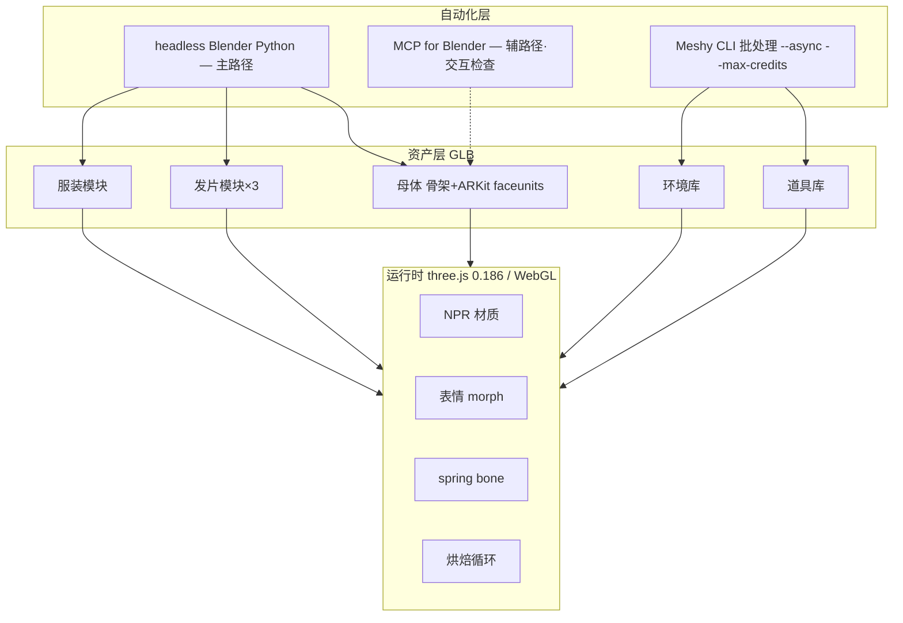

# 武侠风格化 3D 角色：执行方案与门禁

制定日期：2026-10-03。状态：**已获用户批准，进入执行**。
目标线：**风格化**（非写实还原）。Meshy：**7,945 月度积分 / 0 永久 / 17 天后重置**。

配套阅读：[高保真渲染调研](wuxia-high-fidelity-render-research.md)（六轴调研汇总与全部技术论据）· [模块化角色制作调研](modular-character-production-research.md)（模块契约）· [真实 3D 首轮执行](wuxia-true3d-execution-2026-09-30.md)。

---

## 0. 用户已确认的三项决策

| # | 决策 | 影响 |
|---|---|---|
| 1 | **允许安装第三方 MCP**（`mcp-for-blender`，MIT，非 Blender 官方） | 获得交互式检查能力；需接受"执行任意 Python"权限 |
| 2 | **接受 NPR 硬分界着色** | 风格化定调，明显区别于参考图的厚涂写实 |
| 3 | **赛博朋克主题纳入本次积分批次** | P5 批次 462 积分 |

---

## 1. 目标定义（可验收）

| 维度 | 标准 |
|---|---|
| 光照 | 硬分界（明暗过渡区 ≤15%），参考 MToon `shadingToonyFactor` 0.9 语义 |
| 边缘光 | 青白色 rim light，勾人物轮廓与发丝 |
| 描边 | 首版**不做**，先用边缘光 |
| 纹理 | 手绘感基色 + 简化法线，**不要照片级 PBR** |
| 保留设定 | 青白/浅绿配色、束腰护腕、半束长发+发髻、带鞘长剑、交叠腿坐姿、湖山薄雾、右侧暖光 |
| 放弃 | 毛孔级皮肤、逐根发丝、织物纤维、真实透光、浅景深电影感 |
| **通过判据** | 与 R07 并排：**"是这个角色"且"明显是风格化"**，而非"像不像真人" |

---

## 2. 架构



**模块契约（冻结）**：单位米 / +Y 上 / 面朝 +Z；统一 A-pose bind；挂点命名 `scalpFit` `neckSeam` `handGripL` `handGripR` `seatSocket`；`skeletonVersion` 与 `moduleVersion` 入清单。

---

## 3. 自动化基础设施

### 3.1 主路径：headless Blender Python

```powershell
& $BLENDER --background --factory-startup --python scripts/blender/<step>.py -- <args>
```

**为什么是主路径**：项目既有的成功案例（舟/剑审查版的逐字节一致重建）就是靠 headless 脚本做到的。生产步骤必须**确定性、可版本控制、可复现**。项目内已有先例：`art/dual-theme/eastern/production/build-review-prop.py`、`build-scene-blockout.py`。

### 3.2 辅路径：MCP for Blender（第三方）

> ⚠️ **Blender 官方没有 MCP。** `mcp-for-blender`（原 `blender-mcp`，MIT）README 自述：*"This is a third-party integration and not made by Blender"*。

用途仅限**交互式检查**（看姿势、看穿模、看材质）。**不用于生产步骤**。
安全：它能以用户权限执行任意 Python，因此只在本机回环、用完即关。

### 3.3 环境清单

| 依赖 | 状态 |
|---|---|
| Blender 4.5.5 LTS | ✅ headless 烟测通过 |
| uv / uvx 0.12.2 | ✅ |
| Python 3.14.2 | ✅ |
| MPFB2 | 待装（Blender 官方扩展平台） |
| mcp-for-blender | 待装 |
| @gltf-transform/cli | 待补 |

---

## 4. Meshy 积分批次

| 批次 | 内容 | 数量 | 小计 |
|---|---|---:|---:|
| **P0 探针** | Ultra entitlement / Web 端 0 积分验证 / `smart-topology` 语义分件 / 骨骼与手指骨 / 真实单价校准 | 6 次 | ≤60 |
| **P1 武侠道具** | 剑形制×3、鞘×2、发簪×6、发冠×2、耳坠×3、玉坠×2、护腕×2、腰封扣×3、靴×2 | 25 | 825 |
| **P2 生活器物** | 茶具、酒壶、竹简、卷轴、古琴、棋笥、香炉、斗笠、蓑衣、鱼篓、灯笼×3 | 15 | 495 |
| **P3 环境** | 山石×8、松×4、竹×3、芦苇×3、莲叶×3、悬崖×2、远山×3、水岸石阶×2、苔石×3、枯枝×3 | 34 | 1,122 |
| **P4 舟体细节** | 舱盖、竹篙、船桨、缆桩、缆绳、木构件×6 | 11 | 363 |
| **P5 赛博朋克** | 诊疗椅、工作台、机械臂、显示器组、线缆束、霓虹灯牌、工具箱、义体托盘、药品架、设备壳×4 | 14 | 462 |
| **P6 形状草稿** | 发型体块×12、服装轮廓×8 | 20 | 660 |
| **P7 2D 素材** | 纹样、刺绣、布料纹理、色板、风格化概念图 | 90 | 810 |
| **P8 重试** | 不合格重掷 | 60 | 1,980 |
| **P9 缓冲** | 应急 + 单价校准后余额再分配 | — | ≈1,100 |
| | **合计** | | **≈7,877 / 7,945** |

**执行纪律**：先 `--dry-run` 估；提交带 `--max-credits`；`--async` 批处理；**立即下载**（API 资产仅保留 3 天）；台账逐条记 `task_id / consumed_credits / sha256`；每日 `meshy api GET /balance` 对账。

**不做**：对已绑定模型 retexture、期望 Meshy 出表情或换装分件、`gltf-transform optimize` 的默认 simplify（只按位置简化，会毁 UV 与权重）。

---

## 5. 阶段门禁

| 门 | 产物 | 通过标准 |
|---|---|---|
| **G0 环境** | MPFB2 + MCP + 脚本骨架 + 端到端烟测 | 烟测绿 |
| **G1 母体与着色** | 风格化母体 + NPR 材质 | 与 R07 并排："是这个角色"且"明显风格化" |
| **G2 头发** | 三组发片 + 图集 | 多角度无碎片；发根稳；深色背景不闪灭 |
| **G3 服装与坐姿** | 分层衣装 + 交叠腿 + 持剑接触 | 裙摆自然；手不穿柄；呼吸不穿肉 |
| **G4 表情与运动** | 12–16 blendshape + 循环 | 三态成立；循环首尾不跳 |
| **G5 资产库** | Meshy 批次入库校验 | 每件有哈希台账 |
| **G6 网页装配** | `/design/wuxia` 扩展 + 性能报表 | 见 §6 |

---

## 6. 验收标准

视觉（并排可辨识、风格明确、无穿模）· 表情（眨眼/张嘴/微笑近景不破面）· 运动（6–10 秒循环无缝）· 性能（桌面接近 60 FPS，记录帧时间/draw call/显存）· **体积（分别报告"下载字节"与"显存占用"——PNG/JPEG 显存可达 KTX2 的 4–8 倍）** · 降级（WebGL 失败 → 静态海报 + HTML 可用）· **业务 HTML 不依赖 3D 是否加载成功**

---

## 7. 风险与回退

| 风险 | 缓解 |
|---|---|
| 风格化脸"不像这个角色" | MPFB2 参数可迭代；留 KeenTools FaceBuilder（$191.88/年）作后手 |
| 程序化发片达不到观感 | HairTG-Cards 2 作后手；或退到"实体发束 + 各向异性" |
| 单价高于预估 | P0 校准 + P9 缓冲兜底 |
| 美术判断反复 | 决策点压到 3–4 次，每次给并排对照图 |

**回退**：所有 GLB 新文件不覆盖旧文件；任一阶段不通过可停在"静态海报 + HTML"降级态。

---

## 8. 非目标

❌ 逐像素还原写实质感 · ❌ 实时布料求解 / 发丝级 groom · ❌ 3DGS 神经头像 · ❌ 迁移 WebGPU · ❌ 真人级 669 blendshape · ❌ Meshy 做表情或换装分件 · ❌ 发布/部署（需另行授权）
