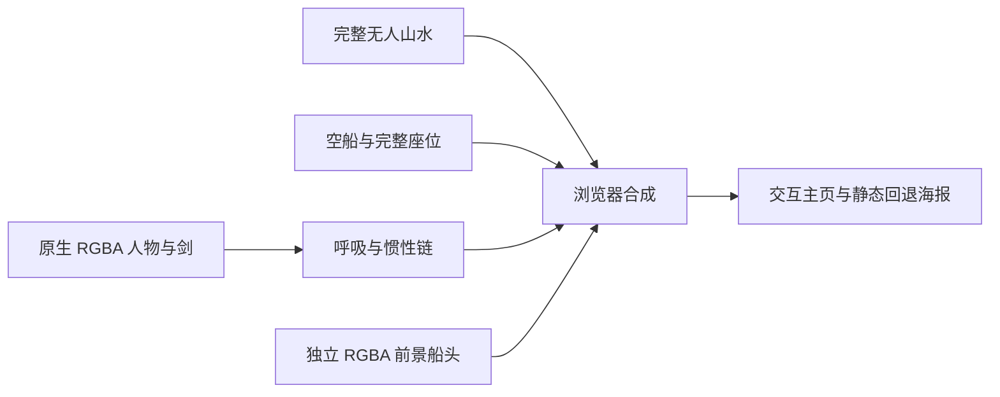

# 云水之间 V2：独立分层与待机动作

2026-10-17。当前版本已在本地实现并完成正式构建与浏览器验证，最终美术签收待用户判断。V1 的原图加 SVG 遮罩路线已退出当前动态渲染，见 [V1 记录](archive/wuxia-living-portrait-v1.md)。

2026-11-09 仓库清理：首页已改为 VRM 管家，本场景仅保留在 `/scenes/wuxia`。运行时只需要 `apps/web/public/scenes/wuxia/v2/` 中已发布的图层和清单；制作源图、离线审查页、录屏和资产构建脚本已移出仓库，因此重新制作图层需要另行恢复这些源文件。

## 直接查看

- [完整交互场景](http://127.0.0.1:3100/scenes/wuxia)：当前正式构建在本地 3100 端口运行。
- [共享主页布局](http://127.0.0.1:3100/scenes/wuxia?view=home)：真实 HomeDashboard 组件的公开空状态，不读取账号。

## 本轮解决的问题

V1 从完整原图取色再套近似遮罩。发丝和柔焦船头的像素混入原背景，扩大或羽化遮罩无法恢复干净的前景颜色；背景补位也依赖局部遮罩。V2 改为真正独立的山水、空船、透明人物和透明船头，绘制顺序如下：



四个动态层都不采样输入合成图。原图仅在用户点击“对照原图”时展示。人物、空船和船头通过内置 imagegen 依据参考重新制作，输出有真实透明通道；背景复用既有 R06 无人山水。先保留一轮风吹过大的候选，再制作更接近输入图的垂落发型。当前发布的是 `character-native-v2.png`。

这不是无损恢复原始分层工程：再制作改变了部分脸部、衣发、船体与背景构图。输入图与当前合成并排保留，不能将透明度检查、测试或导出成功当作外观一致性签收。

船头遮挡也做了对照实验：以临时曲线切分完整空船，会把船内地板误放到人物前面，造成衣裙硬截断。该实现已移除，当前使用单独制作的透明船头，渲染器中没有这条切分曲线。

## 动作实现

| 部位 | 当前处理 |
|---|---|
| 呼吸节奏 | 吸气 2.2 秒、呼气 3.6 秒，转折处速度连续；不乘风力参数 |
| 头与脸 | 整体平移约 1.5 源像素、轻微转角；脸部所在区域作刚性变换，不拉伸五官 |
| 颈、肩、胸口 | 颈部过渡，胸肩微小上抬及横向扩展，腰以下不参与呼吸变形 |
| 双手、剑与坐姿 | 保留接触基准，局部动作权重不影响这些位置 |
| 发尾、袖边、裙边、剑穗 | 六条固定步长惯性链；阻尼、形状回弹、重力、统一风力与长度约束 |
| 水面、雾 | 独立背景着色器中的小幅扰动与漂移 |

惯性链以 1/120 秒固定步长运行，每次最多接纳 1/30 秒时间，不积累暂停或后台时间。根部跟随所属部位；自由端会滞后，风停止后服饰链逐渐稳定。绘制网格使用这些链的路径权重，根部与接触点保持固定。

这是受约束的二维网格微动，不能等同于三维衣料、发丝级物理或神经视频。原生 RGBA 人物内部没有完整的可替换头部、袖片和被遮挡身体图层；当前只允许很小的呼吸和次级动作，不承诺大幅转头、换姿或自由镜头。尚未制作眨眼与新表情。

## 实际验证

正式构建 `OKMVfnzYdcVHneUF_yCaI`；全量 **1298** 项 Vitest、Web TypeScript 检查、Next.js 正式构建均通过。

| 检查 | 当前证据 |
|---|---|
| 原生透明素材 | 人物、船和船头解码出真实 alpha；在白、黑、棋盘和对比色底上实际显示并保存截图 |
| 呼吸修复 | 原实现的“无风也呼吸”测试先失败；改后无风时浏览器头部、胸肩区域均发生可测变化 |
| 头脸保护 | 同一头部变换下，多组面部坐标距离保持一致；不是让面部完全静止 |
| 接触保护 | 一次呼吸前后，实际画布握剑手区域平均像素差为 0 |
| 次级动作 | 固定视角的头发、衣摆均发生可测变化；链长、根部、停止后稳定及 30/60/120 FPS 一致性有单测 |
| 视差 | 实际图像区域匹配：人物向右 14px，山水向左 10px |
| 暂停与回退 | 暂停后时钟及截图相同；离屏暂停；加载失败、WebGL 丢失、无 WebGL、无 JS 均有静态回退，重试成功 |
| 窄屏与触摸 | 390px 无水平溢出；DPR=3 模拟设备中画布 362px，原生模拟触摸让页面滚动 68px |
| 资源与来源 | 三次重入为每个渲染器 4 纹理、2 几何；HTTP 图片哈希与源清单一致 |
| 运行错误 | 正常流程无控制台错误、未处理异常或外部网络请求 |

Windows Chrome / AMD Radeon 8060S / ANGLE D3D11，1344×757 画布，活动测量 60.008 秒：3601 次场景回调，约 60.01 次/秒；RAF 间隔中位数 16.7ms、P95 17.0ms、最大 18.5ms；动作调度 CPU P95 0.200ms。此指标包含动作推进与参数更新，不是 GPU 绘制耗时，也不是显示器实际呈现 FPS。四张动态 PNG 传输合计 **4,309,304 字节 / 4.11 MiB**，另需静态合成海报和 JavaScript。

实体 Android/iPhone Safari、登录账号后的完整业务主页、十分钟全局显存稳定性尚未实测。Headless Chrome 没有把后台页标为隐藏，不能声称已实测真实后台标签暂停；隐藏事件有受控组件测试，离屏暂停有实际运行证据。动作自然程度与人物外观均仍需视觉签收。

## 源文件与重建

| 文件 | 职责 |
|---|---|
| `apps/web/public/scenes/wuxia/v2/` | 已发布的四个图层、海报、对照图与 SHA-256 清单；清单中的 `source` 是已移出仓库的制作源路径 |
| `apps/web/src/lib/scene/living-portrait-rig-config.json` | 当前素材、装配位置、解剖基准和六条链的可编辑路径 |
| `living-portrait-rig.ts`（同目录） | 呼吸、固定步长链求解、权重与由同一配置生成的着色器 |
| `apps/web/src/components/wuxia/living-portrait-canvas.tsx` | 四层渲染、纹理生命周期与帧调度 |
| `living-portrait.tsx`（同目录） | 延迟加载、暂停、键盘、减少动态效果、回退与重试 |
| `scripts/verify-wuxia-living-v2.cjs` | 正式浏览器动作、性能、失败、视差与 HTTP 身份验证 |
| `scripts/verify-wuxia-living-touch.cjs` | 触屏滚动与交互验证（`--v2`） |

素材制作使用了内置 imagegen，没有使用 CLI/API 回退、下载大型模型或新增 npm 依赖。它不是开源图像模型的本地推理；不能把前期“全开源制作”设想写成已兑现。浏览器运行完全本地，不依赖生成服务。用户参考与生成图片的权利来源分别记录，不从项目 MIT 代码许可推导资产许可。

当前生成工具并不提供可确定性复现的模型版本和种子，因此可重复的是**已保存素材的装配、动作与发布**，不是重新运行提示词必然得到相同图片。素材构建、海报与离线审查脚本已随制作源文件移出仓库。

```powershell
npm run build:web
npm run start -w @blueprint/web -- --hostname 127.0.0.1 --port 3100
node scripts/verify-wuxia-living-v2.cjs --production
node scripts/verify-wuxia-living-touch.cjs --v2
```

代码侧证据保存于 `.goal-loop/evidence/wuxia-living-v2-2026-10-17/`；使用 Node 24.19 运行 Vitest、TypeScript 与构建。本机默认 Node 26 的 JSDOM 全局对象差异仍存在，优先使用 Node 24 调用对应本地脚本。开发服务与正式构建不得同时写入同一个 `.next`。本轮没有提交、推送或部署。
